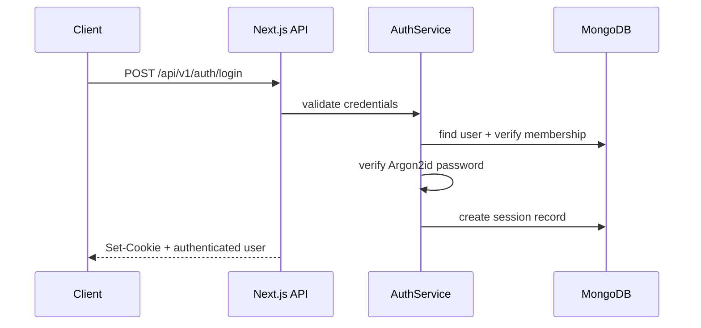
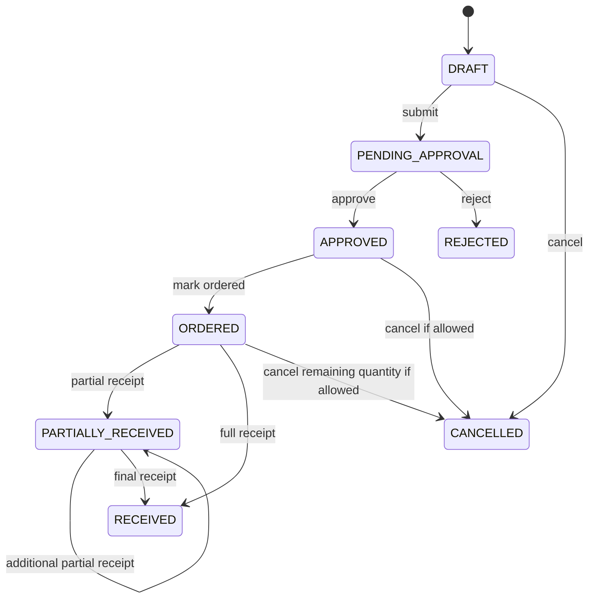
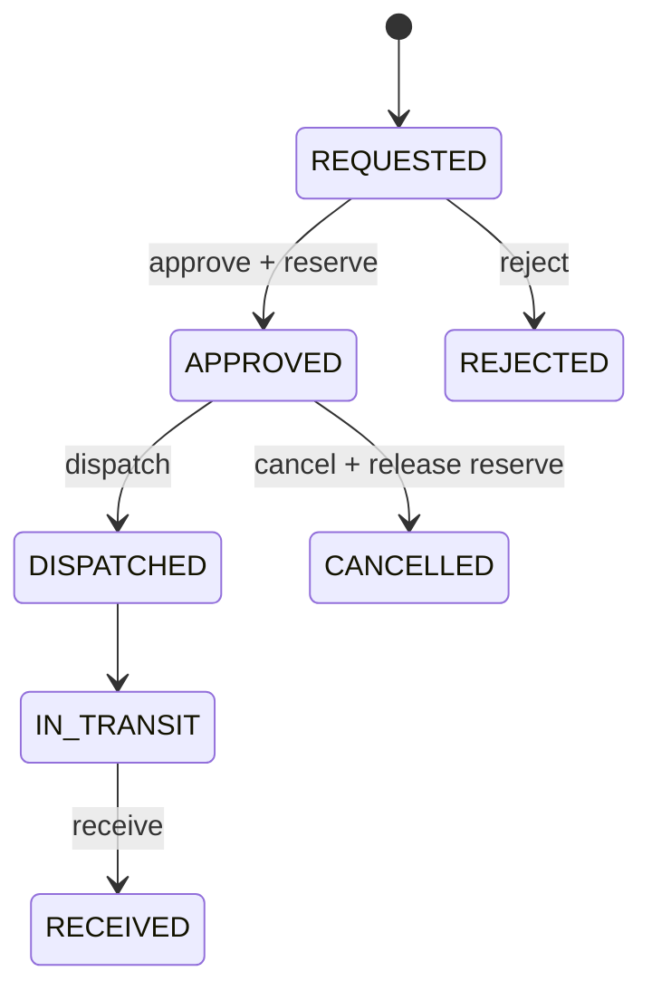
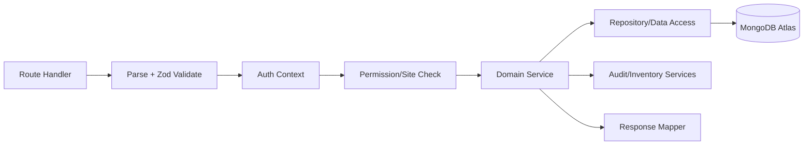
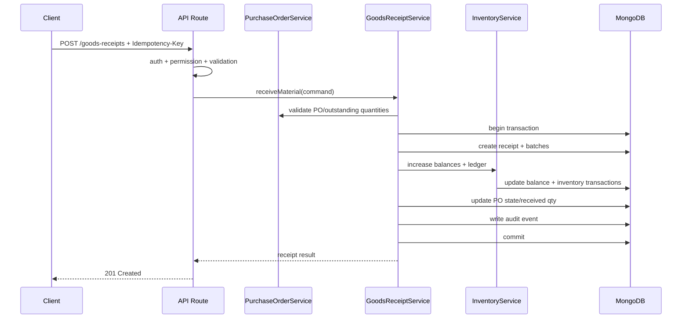
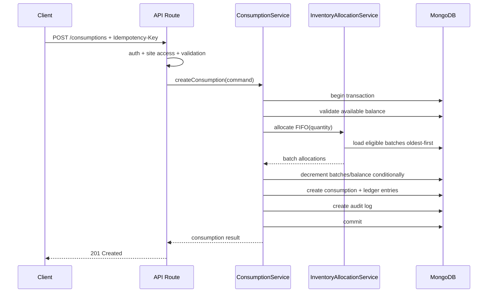
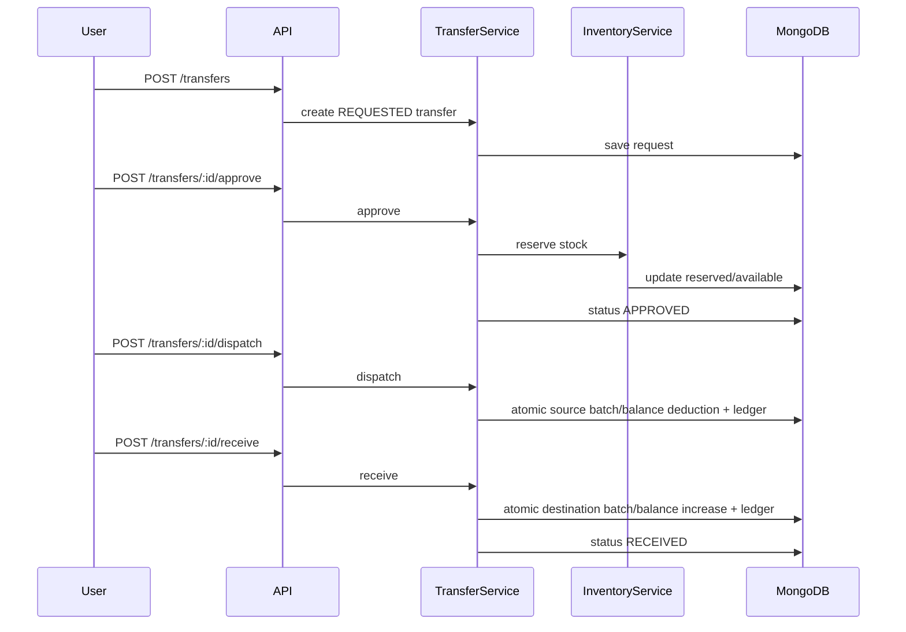

# ConstructStock - API Design Document

**Multi-company Construction Material Inventory & Waste Management SaaS**

| Item | Decision |
|---|---|
| Version | 1.0 |
| API Style | REST |
| Base Path | `/api/v1` |
| Application | Full-stack Next.js modular monolith |
| Runtime | Node.js via Next.js |
| Authentication | Custom server-side session authentication |
| Database | MongoDB Atlas |
| Tenant Model | Shared collections with `organizationId` isolation |
| Deployment | Vercel |
| Primary Client | Responsive web application |
| Future Client | Mobile application using the same REST API |

> **Status:** This document defines the baseline API contract for ConstructStock v1. Endpoint names, payloads, status transitions, authorization rules, and inventory mutation guarantees should be treated as implementation requirements unless explicitly revised.

---

# 1. Purpose

This document defines the REST API contract for ConstructStock. It translates the approved Product Requirements Document, System Design Architecture, and MongoDB Database Design into implementable HTTP endpoints, request/response models, authorization rules, validation behavior, workflow transitions, error contracts, pagination conventions, and consistency guarantees.

The API is designed to serve the current Next.js web application and a future mobile application without duplicating business logic. The web application may call service-layer code directly from server-rendered components for internal reads, but all externally supported client operations must remain representable through the versioned `/api/v1` REST contract.

---

# 2. API Goals

The API must:

- expose stable, versioned business operations under `/api/v1`;
- enforce strict multi-tenant isolation on every tenant-owned resource;
- enforce role- and site-based authorization on the server;
- protect inventory integrity during receiving, consumption, wastage, and transfers;
- support idempotent critical stock mutations;
- preserve immutable inventory and audit history;
- provide predictable JSON response and error formats;
- support filtering, pagination, sorting, and date-range queries;
- support responsive web usage now and mobile usage later;
- keep workflow transitions explicit instead of allowing arbitrary status edits;
- remain implementable inside a Next.js modular monolith.

## 2.1 Non-goals

Version 1 will not provide:

- GraphQL;
- public anonymous business-data APIs;
- webhook integrations;
- third-party OAuth login;
- subscription or billing APIs;
- event-streaming APIs;
- microservice-to-microservice APIs;
- public developer API keys.

---

# 3. API Principles

| Principle | Rule |
|---|---|
| Versioned contract | All supported business endpoints are under `/api/v1`. |
| Server-derived tenancy | `organizationId` is derived from the authenticated membership/session and is not trusted from the request body. |
| Explicit workflows | Approval, dispatch, receipt, cancellation, and reversal are represented as explicit action endpoints. |
| Ledger-first inventory | No stock mutation succeeds without corresponding `inventory_transactions`. |
| Idempotent critical writes | Receiving, consumption, wastage, transfer dispatch/receipt, and adjustments require idempotency protection. |
| Immutable history | Finalized stock movements are reversed or corrected, never deleted or silently edited. |
| Least privilege | Authorization checks membership, role/permission, organization status, and site assignment. |
| Bounded payloads | API request sizes, page sizes, file sizes, and filter ranges are bounded. |
| Consistent errors | Domain failures return machine-readable error codes. |
| Mobile-ready | Endpoint behavior does not depend on browser-only assumptions. |

---

# 4. Base URL and Versioning

Production API:

```text
https://<constructstock-domain>/api/v1
```

Local development:

```text
http://localhost:3000/api/v1
```

Versioning is path-based:

```text
/api/v1/...
```

Breaking contract changes require a new major API version such as `/api/v2`. Backward-compatible changes may be added to `/api/v1`, including new optional fields, new endpoints, new filter parameters, and new response metadata fields.

---

# 5. Transport and Data Conventions

## 5.1 Content types

Default request and response type:

```http
Content-Type: application/json
Accept: application/json
```

File upload operations may use multipart requests or a signed/direct-upload flow, depending on the storage adapter.

## 5.2 IDs

MongoDB `ObjectId` values are exposed as strings:

```json
{
  "id": "691d9477ab12cd34ef567890"
}
```

Clients must treat IDs as opaque strings.

## 5.3 Dates and times

All API timestamps use ISO 8601 UTC:

```text
2026-11-19T12:45:31.000Z
```

The API stores and returns absolute timestamps in UTC. UI clients may convert them to the user's local timezone.

Date-only business values use:

```text
YYYY-MM-DD
```

Example:

```text
2026-11-19
```

## 5.4 Decimal quantities and money

MongoDB uses `Decimal128` internally for material quantities and monetary values. API payloads represent precise decimals as strings to avoid floating-point precision loss across JavaScript/mobile clients.

Example:

```json
{
  "quantity": "125.50",
  "unitPrice": "390.00",
  "grandTotal": "48769.50"
}
```

The API must reject values with unsupported precision or invalid numeric format.

## 5.5 Enums

Enums are uppercase strings:

```json
{
  "status": "PENDING_APPROVAL"
}
```

Clients must not rely on display labels being identical to enum values.

---

# 6. Standard Response Envelope

## 6.1 Successful single-resource response

```json
{
  "success": true,
  "data": {
    "id": "..."
  },
  "meta": {
    "requestId": "req_..."
  }
}
```

## 6.2 Successful list response

```json
{
  "success": true,
  "data": [
    {}
  ],
  "meta": {
    "requestId": "req_...",
    "pagination": {
      "nextCursor": "...",
      "hasMore": true,
      "limit": 25
    }
  }
}
```

## 6.3 Error response

```json
{
  "success": false,
  "error": {
    "code": "INSUFFICIENT_STOCK",
    "message": "Only 75 cement bags are currently available.",
    "details": {
      "availableQuantity": "75",
      "requestedQuantity": "100"
    }
  },
  "meta": {
    "requestId": "req_..."
  }
}
```

`message` is human-readable. Client logic should depend on `code`, not the message string.

---

# 7. HTTP Status Codes

| Status | Usage |
|---|---|
| `200 OK` | Successful read or action returning a representation. |
| `201 Created` | New resource created. |
| `202 Accepted` | Reserved for future asynchronous operations. |
| `204 No Content` | Successful action with no body where appropriate. |
| `400 Bad Request` | Invalid input, malformed query, or failed business precondition not better represented by 409/422. |
| `401 Unauthorized` | Missing, expired, or invalid authentication session. |
| `403 Forbidden` | Authenticated but not permitted for role, organization, or site. |
| `404 Not Found` | Resource absent or intentionally hidden because it belongs to another tenant. |
| `409 Conflict` | State transition conflict, duplicate code, concurrent version conflict, or idempotency conflict. |
| `422 Unprocessable Entity` | Structurally valid request that fails field/domain validation. |
| `429 Too Many Requests` | Rate limit exceeded. |
| `500 Internal Server Error` | Unexpected server error. |
| `503 Service Unavailable` | Temporary dependency outage when appropriate. |

Cross-tenant resource access should normally return `404` rather than revealing that another tenant's resource exists.

---

# 8. Authentication and Session API

ConstructStock uses custom authentication with opaque server-side sessions stored in MongoDB and a secure HttpOnly session cookie for the web client.

## 8.1 Authentication flow



## 8.2 Authentication endpoints

| Method | Endpoint | Auth | Purpose |
|---|---|---:|---|
| `POST` | `/auth/register-company` | No | Register a new company and first Owner. |
| `POST` | `/auth/login` | No | Create authenticated session. |
| `POST` | `/auth/logout` | Yes | Revoke current session. |
| `GET` | `/auth/csrf` | Yes | Return a session-bound token for browser mutations. |
| `POST` | `/auth/logout-all` | Yes | Revoke all sessions for current user. |
| `GET` | `/auth/me` | Yes | Return current user, membership, permissions, and assigned sites. |
| `POST` | `/auth/forgot-password` | No | Initiate password reset. |
| `POST` | `/auth/reset-password` | No | Reset password with single-use token. |
| `POST` | `/auth/change-password` | Yes | Change password for authenticated user. |

## 8.3 Register company

### `POST /api/v1/auth/register-company`

Request:

```json
{
  "companyName": "ABC Construction Pvt Ltd",
  "ownerName": "Rohan Darji",
  "email": "owner@example.com",
  "password": "<user-password>",
  "currencyCode": "INR"
}
```

Response `201`:

```json
{
  "success": true,
  "data": {
    "organization": {
      "id": "...",
      "name": "ABC Construction Pvt Ltd",
      "status": "ACTIVE",
      "currencyCode": "INR"
    },
    "user": {
      "id": "...",
      "name": "Rohan Darji",
      "email": "owner@example.com"
    },
    "membership": {
      "role": "OWNER",
      "status": "ACTIVE"
    }
  },
  "meta": {
    "requestId": "req_..."
  }
}
```

Rules:

- email must be globally unique;
- organization slug is generated server-side;
- owner membership is created atomically with the organization/user;
- password is stored only as an Argon2id hash;
- the organization currency is selected at registration;
- the Owner may sign in immediately after registration.

## 8.4 Login

### `POST /api/v1/auth/login`

Request:

```json
{
  "email": "owner@example.com",
  "password": "<user-password>"
}
```

Response `200` sets the secure session cookie for browser clients and returns the authenticated identity context.

## 8.5 Current identity

### `GET /api/v1/auth/me`

Response:

```json
{
  "success": true,
  "data": {
    "user": {
      "id": "...",
      "name": "Rohan Darji",
      "email": "owner@example.com"
    },
    "organization": {
      "id": "...",
      "name": "ABC Construction Pvt Ltd"
    },
    "membership": {
      "role": "OWNER",
      "permissions": [
        "site.manage",
        "purchase_order.approve",
        "transfer.approve",
        "reports.view"
      ]
    },
    "siteAssignments": []
  },
  "meta": {
    "requestId": "req_..."
  }
}
```

---

# 9. CSRF and Browser Security

Cookie-authenticated state-changing requests must include CSRF protection. The implementation may use a synchronized/double-submit token strategy, but the API contract should expose a predictable mechanism.

Recommended browser request headers:

```http
X-CSRF-Token: <token>
```

The API also validates request origin/host for browser-originated unsafe methods where appropriate.

Session cookies must be `HttpOnly`, `Secure` in production, and use an appropriate `SameSite` policy.

`GET /api/v1/auth/csrf` returns a session-bound token for `X-CSRF-Token` on authenticated unsafe requests. The response is private and not cached.

---

# 10. Authorization Model

Every protected request passes the following checks:

```text
Valid session
  -> active user
  -> active organization
  -> active membership
  -> required permission
  -> required site assignment where applicable
  -> target resource belongs to authenticated organization
```

Roles:

- `OWNER`
- `ADMIN`
- `SITE_MANAGER`
- `STOREKEEPER`
- internal `PLATFORM_ADMIN` for platform operations

Representative permissions:

```text
organization.manage
user.manage
site.manage
material.manage
supplier.manage
purchase_order.create
purchase_order.approve
purchase_order.order
inventory.view
inventory.receive
inventory.consume
inventory.adjust
wastage.create
transfer.request
transfer.approve
transfer.dispatch
transfer.receive
reports.view
audit.view
```

Authorization is permission-based in application code even when permissions are derived from roles.

---

# 11. Pagination, Filtering and Sorting

## 11.1 Pagination

Cursor pagination is the default for large collections.

Example:

```http
GET /api/v1/inventory/transactions?limit=25&cursor=<opaque-cursor>
```

Rules:

- default `limit`: 25;
- maximum `limit`: 100;
- cursor is opaque and must not be constructed by clients;
- stable ordering includes `_id` as a tie-breaker.

## 11.2 Filtering

Filters are query parameters:

```http
GET /api/v1/purchase-orders?siteId=...&status=PENDING_APPROVAL&supplierId=...
```

Date ranges use:

```http
?from=2026-11-01&to=2026-11-30
```

## 11.3 Sorting

Where supported:

```http
?sort=-createdAt
```

A leading `-` indicates descending order.

Only allowlisted sort fields are accepted.

## 11.4 Search

Text search uses:

```http
?q=cement
```

Search is intentionally scoped to allowlisted fields for each resource.

---

# 12. Idempotency

Critical inventory mutations must support:

```http
Idempotency-Key: <client-generated-unique-value>
```

Required for:

- goods receipt creation/finalization;
- consumption creation;
- wastage creation;
- inventory adjustment;
- transfer dispatch;
- transfer receipt.

The server stores the key with tenant, operation, request hash, response status, and resulting resource ID.

If the same key is repeated with the same request payload, the server returns the original result.

If the same key is reused with a different payload, return:

```http
409 Conflict
```

```json
{
  "success": false,
  "error": {
    "code": "IDEMPOTENCY_KEY_REUSED",
    "message": "This idempotency key was already used with a different request."
  }
}
```

---

# 13. Organization API

| Method | Endpoint | Permission | Purpose |
|---|---|---|---|
| `GET` | `/organization` | authenticated member | Get current organization. |
| `PATCH` | `/organization` | `organization.manage` | Update allowed organization profile fields. |

The tenant ID is not supplied in the route because the active organization is derived from the session/membership context.

---

# 14. User, Membership and Invitation API

## 14.1 Endpoints

| Method | Endpoint | Permission | Purpose |
|---|---|---|---|
| `GET` | `/users` | `user.manage` | List organization users/memberships. |
| `GET` | `/users/:userId` | `user.manage` | Get organization user detail. |
| `POST` | `/users/invitations` | `user.manage` | Invite an employee. |
| `GET` | `/users/invitations` | `user.manage` | List invitations. |
| `POST` | `/users/invitations/:invitationId/resend` | `user.manage` | Reissue invitation. |
| `DELETE` | `/users/invitations/:invitationId` | `user.manage` | Revoke unused invitation. |
| `POST` | `/users/invitations/accept` | token | Accept invitation and create/activate account. |
| `PATCH` | `/users/:userId/membership` | `user.manage` | Change role/status. |
| `PUT` | `/users/:userId/sites` | `user.manage` | Replace site assignments. |
| `POST` | `/users/:userId/deactivate` | `user.manage` | Deactivate membership/user access. |
| `POST` | `/users/:userId/reactivate` | `user.manage` | Reactivate access. |

## 14.2 Invite user

### `POST /api/v1/users/invitations`

Request:

```json
{
  "name": "Amit Patel",
  "email": "amit@example.com",
  "role": "STOREKEEPER",
  "siteIds": [
    "691d9477ab12cd34ef567890"
  ]
}
```

Rules:

- only organization Owner/Admin can invite under default role mapping;
- every supplied site must belong to the current tenant;
- invitation token is single-use and expiring;
- role changes and site assignments create audit logs.

---

# 15. Site API

| Method | Endpoint | Permission | Purpose |
|---|---|---|---|
| `GET` | `/sites` | authenticated member | List sites visible to caller. |
| `POST` | `/sites` | `site.manage` | Create site. |
| `GET` | `/sites/:siteId` | site access | Get site detail. |
| `PATCH` | `/sites/:siteId` | `site.manage` | Update site. |
| `POST` | `/sites/:siteId/archive` | `site.manage` | Archive/soft-delete site. |
| `POST` | `/sites/:siteId/restore` | `site.manage` | Restore archived site if allowed. |

## 15.1 Create site

```json
{
  "code": "SITE-001",
  "name": "Skyline Residency",
  "description": "Residential construction project",
  "location": {
    "address": "...",
    "city": "Amravati",
    "state": "Maharashtra",
    "country": "India"
  },
  "status": "ACTIVE",
  "startDate": "2026-11-01",
  "expectedCompletionDate": "2027-09-30",
  "budget": "25000000.00"
}
```

Site codes are unique within the active organization. The optional budget uses the organization's currency and two decimal places. List results are scoped to the active organization and, for site-scoped roles, active assignments. Listing supports `status`, `q`, `limit`, and `cursor` query parameters; `q` matches site code, name, or city, and archived sites are returned with `status=ARCHIVED`. Mutations require the session-bound CSRF token. Archive and restore preserve the site's previous status and write an audit record.

Archival is rejected while unresolved inventory/open workflows violate archive rules.

---

# 16. Material Category API

| Method | Endpoint | Permission | Purpose |
|---|---|---|---|
| `GET` | `/material-categories` | authenticated member | List active categories. |
| `POST` | `/material-categories` | `material.manage` | Create category. |
| `PATCH` | `/material-categories/:categoryId` | `material.manage` | Update category. |
| `POST` | `/material-categories/:categoryId/archive` | `material.manage` | Archive category. |

The category list may include archived records with `includeArchived=true`. Category names are unique within an organization. A category with any referenced materials cannot be archived; move those materials to another category first.

---

# 17. Material API

| Method | Endpoint | Permission | Purpose |
|---|---|---|---|
| `GET` | `/materials` | authenticated member | List/search materials. |
| `POST` | `/materials` | `material.manage` | Create material. |
| `GET` | `/materials/:materialId` | authenticated member | Get material. |
| `PATCH` | `/materials/:materialId` | `material.manage` | Update allowed master fields. |
| `POST` | `/materials/:materialId/archive` | `material.manage` | Archive material if no active stock/workflows prevent it. |
| `POST` | `/materials/:materialId/restore` | `material.manage` | Restore material. |

Material listing supports `status`, `categoryId`, `q`, `limit`, and `cursor`. Search matches code or name. Material codes are unique within an organization. Quantity strings use whole numbers for `BAG` and `PIECE`; other units allow up to three decimal places. The default reorder quantity, when set, must be positive. Material units cannot change after the first inventory transaction.

Archiving a material returns `409 MATERIAL_HAS_ACTIVE_STOCK` while any site balance or batch holds on-hand or reserved quantity. An open purchase order or transfer also blocks archival with `409 MATERIAL_HAS_OPEN_WORKFLOW`. These checks and the archive state change run in one transaction. Future inventory and purchasing workflows that establish a new material reference must serialize on the material document in their own transactions to prevent a concurrent archive.

Create request:

```json
{
  "code": "CEM-OPC53",
  "name": "OPC 53 Grade Cement",
  "categoryId": "...",
  "unit": "BAG",
  "minimumStockLevel": "100",
  "defaultReorderQuantity": "300"
}
```

---

# 18. Supplier API

| Method | Endpoint | Permission | Purpose |
|---|---|---|---|
| `GET` | `/suppliers` | authenticated member | List/search suppliers. |
| `POST` | `/suppliers` | `supplier.manage` | Create supplier. |
| `GET` | `/suppliers/:supplierId` | authenticated member | Supplier detail. |
| `PATCH` | `/suppliers/:supplierId` | `supplier.manage` | Update supplier. |
| `POST` | `/suppliers/:supplierId/archive` | `supplier.manage` | Archive supplier. |
| `POST` | `/suppliers/:supplierId/restore` | `supplier.manage` | Restore archived supplier. |
| `GET` | `/suppliers/:supplierId/purchase-history` | `reports.view` | Purchase history summary. |

Supplier archive is blocked while an open purchase order references the supplier. Purchase history is derived from purchase orders and will be available with the purchasing module.

---

# 19. Purchase Order API

Purchase orders use action endpoints for state transitions. Clients must not directly PATCH `status`.

## 19.1 Endpoints

| Method | Endpoint | Permission | Purpose |
|---|---|---|---|
| `GET` | `/purchase-orders` | relevant site access | List purchase orders. |
| `POST` | `/purchase-orders` | `purchase_order.create` | Create draft PO. |
| `GET` | `/purchase-orders/:poId` | site access | Get PO detail. |
| `PATCH` | `/purchase-orders/:poId` | creator/authorized role | Edit PO while editable. |
| `POST` | `/purchase-orders/:poId/submit` | `purchase_order.create` | DRAFT -> PENDING_APPROVAL. |
| `POST` | `/purchase-orders/:poId/approve` | `purchase_order.approve` | PENDING_APPROVAL -> APPROVED. |
| `POST` | `/purchase-orders/:poId/reject` | `purchase_order.approve` | PENDING_APPROVAL -> REJECTED. |
| `POST` | `/purchase-orders/:poId/mark-ordered` | `purchase_order.order` | APPROVED -> ORDERED. |
| `POST` | `/purchase-orders/:poId/cancel` | authorized role | Cancel where business rules allow. |
| `GET` | `/purchase-orders/:poId/receipts` | site access | List goods receipts for PO. |

## 19.2 Purchase order state model



## 19.3 Create PO

### `POST /api/v1/purchase-orders`

```json
{
  "siteId": "...",
  "supplierId": "...",
  "expectedDeliveryDate": "2026-11-30",
  "items": [
    {
      "materialId": "...",
      "quantityOrdered": "500",
      "unitPrice": "390.00",
      "taxRate": "18.00"
    },
    {
      "materialId": "...",
      "quantityOrdered": "2000",
      "unitPrice": "65.00",
      "taxRate": "18.00"
    }
  ],
  "notes": "Urgent requirement for slab work"
}
```

The server calculates line totals and PO totals. Client-calculated totals are not authoritative.

## 19.4 Approve PO

### `POST /api/v1/purchase-orders/:poId/approve`

```json
{
  "remarks": "Approved for procurement"
}
```

Returns `409 INVALID_PURCHASE_ORDER_STATE` if the PO is not currently `PENDING_APPROVAL`.

---

# 20. Goods Receipt API

Goods receipt finalization is a critical stock mutation and must be idempotent.

## 20.1 Endpoints

| Method | Endpoint | Permission | Purpose |
|---|---|---|---|
| `GET` | `/goods-receipts` | site access | List receipts. |
| `POST` | `/goods-receipts` | `inventory.receive` | Receive material against an ordered PO. |
| `GET` | `/goods-receipts/:receiptId` | site access | Receipt detail. |
| `POST` | `/goods-receipts/:receiptId/reverse` | `inventory.adjust` | Correct a finalized receipt through reversal workflow. |

## 20.2 Receive material

### `POST /api/v1/goods-receipts`

Headers:

```http
Idempotency-Key: 9d889b41-...
```

Request:

```json
{
  "purchaseOrderId": "...",
  "receivedAt": "2026-11-19T10:30:00.000Z",
  "invoiceNumber": "INV-29392",
  "deliveryChallanNumber": "DC-993",
  "items": [
    {
      "purchaseOrderItemId": "line_1",
      "materialId": "...",
      "quantityReceived": "300",
      "supplierBatchNumber": "CEM-ABC-292",
      "unitCost": "390.00"
    }
  ],
  "notes": "First partial delivery"
}
```

Server-side transactional behavior:

```text
Validate PO state and remaining quantities
  -> create goods receipt
  -> create inventory batch(es)
  -> increase inventory balance
  -> append RECEIPT inventory transaction(s)
  -> update PO received quantities/status
  -> create audit log
  -> commit
```

The request fails atomically if any step fails.

---

# 21. Inventory Read API

## 21.1 Endpoints

| Method | Endpoint | Permission | Purpose |
|---|---|---|---|
| `GET` | `/inventory/balances` | `inventory.view` | Current site/material stock. |
| `GET` | `/inventory/balances/:balanceId` | `inventory.view` | Current balance detail. |
| `GET` | `/inventory/batches` | `inventory.view` | Batch-level stock. |
| `GET` | `/inventory/batches/:batchId` | `inventory.view` | Batch detail/lineage. |
| `GET` | `/inventory/transactions` | `inventory.view` | Ledger history. |
| `GET` | `/inventory/transactions/:transactionId` | `inventory.view` | Ledger entry detail. |
| `GET` | `/sites/:siteId/inventory` | site access | Site-oriented stock view. |
| `GET` | `/materials/:materialId/inventory` | `inventory.view` | Material stock across authorized sites. |

## 21.2 Balance query

```http
GET /api/v1/inventory/balances?siteId=...&materialId=...&lowStock=true
```

Representative response:

```json
{
  "success": true,
  "data": [
    {
      "id": "...",
      "site": {
        "id": "...",
        "code": "SITE-001",
        "name": "Skyline Residency"
      },
      "material": {
        "id": "...",
        "code": "CEM-OPC53",
        "name": "OPC 53 Grade Cement",
        "unit": "BAG"
      },
      "onHandQuantity": "500",
      "reservedQuantity": "100",
      "availableQuantity": "400",
      "minimumStockLevel": "100",
      "inventoryValue": "196000.00",
      "lowStock": false,
      "version": 18,
      "updatedAt": "2026-11-19T10:31:00.000Z"
    }
  ],
  "meta": {
    "requestId": "req_...",
    "pagination": {
      "nextCursor": null,
      "hasMore": false,
      "limit": 25
    }
  }
}
```

---

# 22. Inventory Adjustment API

Manual stock adjustment is exceptional and requires elevated permission plus a reason.

### `POST /api/v1/inventory/adjustments`

Permission: `inventory.adjust`

Headers:

```http
Idempotency-Key: ...
```

Request:

```json
{
  "siteId": "...",
  "materialId": "...",
  "direction": "IN",
  "quantity": "5",
  "unitCost": "250.00",
  "reasonCode": "PHYSICAL_COUNT_CORRECTION",
  "remarks": "Physical count found five additional bags"
}
```

Incoming adjustments require a two-decimal `unitCost` in the organization's currency and create a new costed batch. Do not provide `batchId` for `IN` adjustments. For `OUT` adjustments, omit `unitCost`; the removed quantity uses the existing batch cost. An optional `batchId` targets one existing batch for a specific correction; otherwise stock is removed from available batches in FIFO order. `OPENING_STOCK` is valid only for `IN` adjustments.

Rules:

- adjustment requires audit log;
- negative adjustments may not make available/on-hand stock invalid;
- adjustment creates `ADJUSTMENT_IN` or `ADJUSTMENT_OUT` ledger entry;
- previous ledger history is not edited.

---

# 23. Consumption API

Consumption is a critical FIFO stock mutation.

## 23.1 Endpoints

| Method | Endpoint | Permission | Purpose |
|---|---|---|---|
| `GET` | `/consumptions` | site access | List consumption records. |
| `POST` | `/consumptions` | `inventory.consume` | Issue/consume material. |
| `GET` | `/consumptions/:consumptionId` | site access | Consumption detail. |
| `POST` | `/consumptions/:consumptionId/reverse` | `inventory.adjust` | Reverse incorrect consumption. |

## 23.2 FIFO consumption

### `POST /api/v1/consumptions`

Headers:

```http
Idempotency-Key: ...
```

Request:

```json
{
  "siteId": "...",
  "materialId": "...",
  "quantity": "120",
  "activity": "FIRST_FLOOR_SLAB",
  "issuedTo": "Contractor A",
  "allocationMethod": "FIFO",
  "remarks": "Concrete work"
}
```

The client does not need to choose batches for FIFO.

Transactional server behavior:

```text
Validate site access
  -> read/lock current balance conditionally
  -> ensure available stock >= requested quantity
  -> select oldest eligible batches
  -> decrement batch remaining quantities
  -> update balance
  -> create consumption document with allocations
  -> append one ledger transaction per allocated batch
  -> create audit log
  -> commit
```

Example allocation result:

```json
{
  "allocationMethod": "FIFO",
  "batchAllocations": [
    {
      "batchId": "batchA",
      "quantity": "50"
    },
    {
      "batchId": "batchB",
      "quantity": "70"
    }
  ]
}
```

## 23.3 Manual batch override

Authorized callers may send:

```json
{
  "siteId": "...",
  "materialId": "...",
  "quantity": "120",
  "allocationMethod": "MANUAL",
  "batchAllocations": [
    {
      "batchId": "...",
      "quantity": "120"
    }
  ],
  "overrideReason": "Using batch reserved for specific concrete grade"
}
```

Manual override requires explicit permission and a non-empty reason.

---

# 24. Wastage API

| Method | Endpoint | Permission | Purpose |
|---|---|---|---|
| `GET` | `/wastages` | site access | List wastage. |
| `POST` | `/wastages` | `wastage.create` | Record stock wastage. |
| `GET` | `/wastages/:wastageId` | site access | Wastage detail. |
| `POST` | `/wastages/:wastageId/reverse` | `inventory.adjust` | Reverse incorrect wastage. |

### `POST /api/v1/wastages`

Headers:

```http
Idempotency-Key: ...
```

Request:

```json
{
  "siteId": "...",
  "materialId": "...",
  "quantity": "20",
  "reason": "BREAKAGE",
  "activity": "BRICKWORK",
  "allocationMethod": "FIFO",
  "notes": "Damaged during internal handling",
  "attachmentIds": [
    "file_..."
  ]
}
```

The server allocates batches using the same stock allocation engine used for consumption unless manual allocation is explicitly authorized.

---

# 25. Transfer API

Transfers are explicit workflow resources connecting two sites in the same organization.

## 25.1 Endpoints

| Method | Endpoint | Permission | Purpose |
|---|---|---|---|
| `GET` | `/transfers` | relevant site access | List transfers visible to caller. |
| `POST` | `/transfers` | `transfer.request` | Create/request transfer. |
| `GET` | `/transfers/:transferId` | relevant site access | Transfer detail. |
| `POST` | `/transfers/:transferId/approve` | `transfer.approve` | Approve request and reserve stock. |
| `POST` | `/transfers/:transferId/reject` | `transfer.approve` | Reject request. |
| `POST` | `/transfers/:transferId/dispatch` | `transfer.dispatch` | Dispatch and remove source on-hand stock. |
| `POST` | `/transfers/:transferId/receive` | `transfer.receive` | Receive and add destination stock. |
| `POST` | `/transfers/:transferId/cancel` | authorized role | Cancel where state allows. |

## 25.2 Transfer state model



`DISPATCHED` and `IN_TRANSIT` may be represented as separate states in storage while the dispatch endpoint transitions through the operational state defined by implementation. The externally observable contract must remain consistent.

## 25.3 Create transfer request

```json
{
  "sourceSiteId": "...",
  "destinationSiteId": "...",
  "materialId": "...",
  "quantity": "100",
  "reason": "Destination site is below minimum stock",
  "remarks": "Required for slab work"
}
```

Rules:

- source and destination must belong to current organization;
- source and destination must differ;
- caller must have access to the relevant site under role rules;
- request creation does not reduce stock.

## 25.4 Approve transfer

Approval reserves source inventory:

```text
onHand = unchanged
reserved += approved quantity
available = onHand - reserved
```

If enough available stock no longer exists at approval time, return `409 INSUFFICIENT_STOCK`.

## 25.5 Dispatch transfer

Headers:

```http
Idempotency-Key: ...
```

Server behavior:

```text
validate APPROVED state
  -> release matching reservation
  -> allocate/decrement source batches
  -> reduce source on-hand
  -> append TRANSFER_OUT ledger transactions
  -> store batch allocation lineage
  -> update transfer status
  -> commit
```

## 25.6 Receive transfer

Headers:

```http
Idempotency-Key: ...
```

Server behavior:

```text
validate IN_TRANSIT/DISPATCHED state
  -> create destination-derived batch(es)
  -> increase destination inventory balance
  -> append TRANSFER_IN ledger transactions
  -> mark transfer RECEIVED
  -> audit
  -> commit
```

Destination batches preserve lineage through source batch IDs and transfer ID rather than reusing the same batch document.

---

# 26. Alert API

| Method | Endpoint | Permission | Purpose |
|---|---|---|---|
| `GET` | `/alerts` | authenticated member | List visible alerts. |
| `GET` | `/alerts/:alertId` | resource access | Alert detail. |
| `POST` | `/alerts/:alertId/acknowledge` | authenticated member | Mark alert acknowledged where applicable. |
| `POST` | `/alerts/:alertId/resolve` | authorized role | Resolve actionable alert. |

Common alert types:

```text
LOW_STOCK
OUT_OF_STOCK
PENDING_DELIVERY
DELAYED_PURCHASE_ORDER
HIGH_WASTAGE
TRANSFER_PENDING_APPROVAL
```

Some dashboard warnings may be calculated dynamically rather than persisted as alert resources.

---

# 27. Dashboard API

### `GET /api/v1/dashboard`

Permission: authenticated organization member.

Optional filters:

```text
siteId
from
to
```

Response structure:

```json
{
  "success": true,
  "data": {
    "metrics": {
      "activeSites": 4,
      "inventoryValue": "1840000.00",
      "lowStockItems": 6,
      "outOfStockItems": 1,
      "pendingDeliveries": 3,
      "todayConsumptionValue": "48200.00",
      "wastagePercentage": "2.70",
      "pendingTransfers": 2
    },
    "charts": {
      "monthlyConsumption": [],
      "monthlyPurchasing": [],
      "wastageByCategory": [],
      "inventoryValueBySite": []
    },
    "recentTransactions": [],
    "alerts": []
  },
  "meta": {
    "requestId": "req_..."
  }
}
```

Dashboard output is an aggregated read model and must not be used as the authoritative source for inventory mutations.

---

# 28. Report API

Reports are generated from tenant-scoped MongoDB aggregations for v1.

## 28.1 Endpoints

| Method | Endpoint | Permission | Purpose |
|---|---|---|---|
| `GET` | `/reports/inventory` | `reports.view` | Current inventory report. |
| `GET` | `/reports/purchases` | `reports.view` | Purchase report. |
| `GET` | `/reports/consumption` | `reports.view` | Consumption report. |
| `GET` | `/reports/wastage` | `reports.view` | Wastage report. |
| `GET` | `/reports/suppliers` | `reports.view` | Supplier report. |
| `GET` | `/reports/sites/:siteId` | `reports.view` + site access | Site report. |
| `GET` | `/reports/inventory/export` | `reports.view` | Export PDF/Excel where supported. |
| `GET` | `/reports/consumption/export` | `reports.view` | Export report. |
| `GET` | `/reports/wastage/export` | `reports.view` | Export report. |
| `GET` | `/reports/purchases/export` | `reports.view` | Export report. |

Common query filters:

```text
from
to
siteId
materialId
categoryId
supplierId
format=pdf|xlsx
```

Synchronous export is acceptable for bounded MVP reports. If reports become large, the contract can evolve to an asynchronous export job endpoint without changing the core reporting resource model.

---

# 29. Audit Log API

| Method | Endpoint | Permission | Purpose |
|---|---|---|---|
| `GET` | `/audit-logs` | `audit.view` | List tenant audit events. |
| `GET` | `/audit-logs/:auditLogId` | `audit.view` | Audit detail. |

Filters:

```text
actorUserId
entityType
entityId
action
from
to
```

Audit logs are read-only through normal customer APIs.

---

# 30. File/Attachment API

Files are stored outside MongoDB. MongoDB stores metadata and business references.

Recommended abstraction:

| Method | Endpoint | Permission | Purpose |
|---|---|---|---|
| `POST` | `/files/upload` | authenticated member | Upload allowed attachment. |
| `GET` | `/files/:fileId` | resource access | Get metadata/download URL. |
| `DELETE` | `/files/:fileId` | authorized + unused/unlocked file | Delete unattached/allowed file. |

The implementation may internally use Vercel Blob direct upload tokens. The public business contract should continue to expose a storage-provider-neutral file identifier.

Supported use cases include:

- purchase invoices;
- delivery challans;
- wastage evidence photos;
- other approved transaction attachments.

Files linked to immutable finalized transactions should not be silently removed if doing so would damage audit evidence.

---

# 31. Soft Delete and Archive API Rules

Master data uses archive/restore action endpoints instead of HTTP `DELETE` for normal business operations.

Examples:

```text
POST /materials/:id/archive
POST /materials/:id/restore
POST /sites/:id/archive
POST /suppliers/:id/archive
```

The API rejects archive operations that violate business rules.

Examples:

```json
{
  "code": "MATERIAL_HAS_ACTIVE_STOCK",
  "message": "The material cannot be archived while stock remains at one or more sites."
}
```

Transactional records are not deleted. They are cancelled before finalization or reversed/compensated after finalization.

---

# 32. Concurrency and Optimistic Versioning

Current inventory balance records maintain a server-side `version` field.

Critical inventory mutation logic uses conditional updates within a MongoDB transaction, for example conceptually:

```text
match:
  balanceId = X
  version = 18
  availableQuantity >= requestedQuantity

update:
  available/onHand quantities
  version = 19
```

If another transaction modifies the same balance first, the operation retries safely where appropriate or returns a conflict.

Clients should not implement inventory concurrency themselves.

For editable master/workflow documents, the API may expose `version`/`updatedAt` and accept an expected version for high-conflict edit scenarios.

---

# 33. Inventory Mutation Guarantees

The following invariants are mandatory:

1. No stock mutation without one or more ledger records.
2. No consumption or wastage above available stock.
3. Reserved quantity cannot exceed on-hand quantity.
4. `availableQuantity = onHandQuantity - reservedQuantity`.
5. Batch quantities cannot become negative.
6. FIFO allocates oldest eligible stock first unless manual override is authorized.
7. Transfer approval reserves stock but does not move on-hand stock.
8. Transfer dispatch removes source stock.
9. Transfer receipt adds destination stock and creates new destination batch lineage.
10. Critical multi-document operations commit atomically.
11. Retried requests cannot duplicate stock mutations when the idempotency contract is followed.
12. Finalized ledger records cannot be edited/deleted through normal API endpoints.

---

# 34. Reversal API Pattern

Finalized inventory-affecting documents use explicit reversal endpoints.

Example:

```http
POST /api/v1/consumptions/:id/reverse
```

Request:

```json
{
  "reason": "Quantity entered incorrectly"
}
```

Server behavior:

```text
validate reversible state
  -> create compensating ledger transactions
  -> restore affected batch/balance quantities
  -> link reversal to original document/transactions
  -> mark business document REVERSED where applicable
  -> audit
  -> commit
```

A correction requiring a new correct transaction is performed after the reversal as a separate idempotent business operation.

---

# 35. Validation Rules

Validation occurs in multiple layers:

```text
HTTP request shape (Zod)
  -> authentication
  -> authorization
  -> tenant/resource existence
  -> business state validation
  -> inventory/precondition validation
  -> database constraints/unique indexes
```

Examples:

- quantity must be greater than zero;
- IDs must be valid identifiers;
- material belongs to organization;
- site belongs to organization;
- supplier belongs to organization;
- PO supplier/site cannot be changed after state rules forbid editing;
- received quantity cannot exceed outstanding PO quantity unless a future over-receipt feature explicitly allows it;
- transfer source and destination cannot be identical;
- material unit cannot be changed once historical inventory exists without a migration workflow;
- archived resources cannot be used for new transactions.

Field validation error example:

```json
{
  "success": false,
  "error": {
    "code": "VALIDATION_ERROR",
    "message": "One or more fields are invalid.",
    "details": {
      "fields": {
        "quantity": "Quantity must be greater than zero.",
        "siteId": "Site does not exist or is not accessible."
      }
    }
  },
  "meta": {
    "requestId": "req_..."
  }
}
```

---

# 36. Standard Domain Error Codes

## 36.1 Authentication/security

```text
UNAUTHENTICATED
SESSION_EXPIRED
INVALID_CREDENTIALS
ACCOUNT_INACTIVE
ORGANIZATION_INACTIVE
AUTH_NOT_CONFIGURED
CSRF_VALIDATION_FAILED
RATE_LIMIT_EXCEEDED
```

## 36.2 Authorization

```text
FORBIDDEN
TENANT_ACCESS_DENIED
SITE_ACCESS_DENIED
INSUFFICIENT_PERMISSION
```

## 36.3 General resources

```text
RESOURCE_NOT_FOUND
VALIDATION_ERROR
DUPLICATE_CODE
CONFLICT
VERSION_CONFLICT
RESOURCE_ARCHIVED
```

## 36.4 Purchase orders

```text
INVALID_PURCHASE_ORDER_STATE
PURCHASE_ORDER_NOT_APPROVED
PURCHASE_ORDER_ALREADY_RECEIVED
RECEIPT_EXCEEDS_OUTSTANDING_QUANTITY
```

## 36.5 Inventory

```text
INSUFFICIENT_STOCK
BATCH_NOT_AVAILABLE
BATCH_ALLOCATION_INVALID
MATERIAL_HAS_ACTIVE_STOCK
INVENTORY_VERSION_CONFLICT
INVALID_ADJUSTMENT
TRANSACTION_ALREADY_REVERSED
```

## 36.6 Transfers

```text
INVALID_TRANSFER_STATE
TRANSFER_SITES_MUST_DIFFER
TRANSFER_ALREADY_PROCESSED
TRANSFER_RESERVATION_FAILED
```

## 36.7 Idempotency

```text
IDEMPOTENCY_KEY_REQUIRED
IDEMPOTENCY_KEY_REUSED
IDEMPOTENCY_REQUEST_IN_PROGRESS
```

---

# 37. Request Correlation and Logging

Every request receives a server-generated request ID.

Response header:

```http
X-Request-Id: req_...
```

The same ID appears in response metadata and application logs.

Application logging should record:

- request ID;
- route/method;
- authenticated user ID where safe;
- organization ID where safe;
- status code;
- duration;
- domain error code;
- dependency errors.

Passwords, session tokens, reset tokens, invitation tokens, and sensitive secrets must never be logged.

Audit logging is separate from technical application logging.

---

# 38. Rate Limiting

Rate limits should be applied most aggressively to authentication and abuse-sensitive endpoints.

Examples:

```text
/auth/login
/auth/register-company
/auth/forgot-password
/auth/reset-password
```

General authenticated business endpoints may use broader per-user/per-organization limits.

The exact implementation can evolve, but exceeding the configured limit returns:

```http
429 Too Many Requests
```

with `RATE_LIMIT_EXCEEDED`.

---

# 39. Caching Rules

Version 1 does not require Redis.

Safe read responses may use framework/platform caching only where tenant boundaries and freshness requirements are preserved.

Never cache cross-tenant responses under keys that do not include tenant context.

Inventory balances, approvals, and transaction lists should default to fresh/authoritative reads when stale data could cause an incorrect operation.

Mutation responses are never served from cache.

---

# 40. Next.js API Implementation Structure

Recommended route layout:

```text
src/
  app/
    api/
      v1/
        auth/
        users/
        sites/
        materials/
        material-categories/
        suppliers/
        purchase-orders/
        goods-receipts/
        inventory/
        consumptions/
        wastages/
        transfers/
        alerts/
        dashboard/
        reports/
        audit-logs/
        files/
```

Route handlers remain thin.

Recommended request path:



Route handlers should not contain inventory allocation algorithms, tenant-scoped database queries, or approval state logic directly.

---

# 41. Service Ownership by API Domain

| API Domain | Primary Service(s) |
|---|---|
| Auth | `AuthService`, `SessionService` |
| Users | `UserService`, `MembershipService`, `InvitationService` |
| Sites | `SiteService`, `SiteAccessService` |
| Materials | `MaterialService`, `MaterialCategoryService` |
| Suppliers | `SupplierService` |
| Purchase Orders | `PurchaseOrderService`, `ApprovalService` |
| Receiving | `GoodsReceiptService`, `InventoryService` |
| Inventory | `InventoryService`, `InventoryAllocationService`, `InventoryLedgerService` |
| Consumption | `ConsumptionService`, `InventoryAllocationService` |
| Wastage | `WastageService`, `InventoryAllocationService` |
| Transfers | `TransferService`, `InventoryReservationService`, `InventoryService` |
| Alerts | `AlertService` |
| Dashboard | `DashboardService` |
| Reports | `ReportService` |
| Audit | `AuditService` |
| Files | `FileStorageService` |

---

# 42. Representative Permission Matrix

| Action | Owner | Admin | Site Manager | Storekeeper |
|---|:---:|:---:|:---:|:---:|
| Manage organization | Yes | Limited | No | No |
| Invite/manage users | Yes | Yes | No | No |
| Create/manage sites | Yes | Yes | No | No |
| Manage material catalogue | Yes | Yes | Limited/No | No |
| Manage suppliers | Yes | Yes | Limited | No |
| Create PO | Yes | Yes | Yes | No |
| Approve PO | Yes | Yes | No | No |
| Mark PO ordered | Yes | Yes | Optional | No |
| Receive material | Yes | Yes | Yes | Yes |
| View inventory | Yes | Yes | Assigned sites | Assigned sites |
| Consume/issue material | Yes | Yes | Assigned sites | Assigned sites |
| Record wastage | Yes | Yes | Assigned sites | Assigned sites |
| Request transfer | Yes | Yes | Assigned sites | Optional |
| Approve transfer | Yes | Yes | No | No |
| Dispatch transfer | Yes | Yes | Assigned source | Assigned source |
| Receive transfer | Yes | Yes | Assigned destination | Assigned destination |
| Inventory adjustment | Yes | Restricted | No | No |
| View reports | Yes | Yes | Assigned sites | Limited |
| View audit logs | Yes | Yes | Limited | No |

Final implementation should map permissions explicitly instead of hard-coding this table in route handlers.

---

# 43. API Sequence - Material Receiving



---

# 44. API Sequence - FIFO Consumption



---

# 45. API Sequence - Transfer



---

# 46. OpenAPI Contract Strategy

The implementation should maintain an OpenAPI 3.1 specification for the externally supported `/api/v1` contract.

The OpenAPI definition should describe:

- endpoint paths and methods;
- authentication requirements;
- request schemas;
- response schemas;
- error envelope;
- enums;
- pagination metadata;
- idempotency header requirements;
- representative examples.

Recommended approach:

```text
Zod request/response schemas
        +
API route metadata
        ->
OpenAPI 3.1 document
        ->
Swagger/Scalar-style development documentation
```

The generated contract can later be used to generate typed clients for the mobile application.

The API Design Document remains the higher-level business contract; OpenAPI is the machine-readable implementation contract.

---

# 47. API Testing Strategy

## 47.1 Contract tests

Verify:

- response envelope;
- HTTP status codes;
- validation errors;
- OpenAPI conformance;
- enum values;
- pagination behavior.

## 47.2 Authorization tests

Every tenant/site-sensitive endpoint should include tests for:

- unauthenticated access;
- wrong role;
- correct role but unassigned site;
- resource in another organization;
- archived/inactive organization/member.

## 47.3 Inventory correctness tests

Test:

- receipt increases correct balance/batch;
- FIFO allocation across multiple batches;
- insufficient stock failure;
- reserved stock excluded from available stock;
- concurrent deductions cannot overdraw;
- transfer reservation/dispatch/receipt lifecycle;
- reversal restores the expected quantities;
- ledger entries reconcile to current stock.

## 47.4 Idempotency tests

Test duplicate requests for all critical mutations, including simultaneous retries.

## 47.5 State machine tests

Invalid transitions must fail consistently, for example:

```text
RECEIVED PO -> approve
REQUESTED transfer -> receive
REJECTED PO -> mark ordered
```

---

# 48. Security Testing

The API should be tested for:

- broken object-level authorization;
- cross-tenant ID substitution;
- site assignment bypass;
- CSRF;
- session fixation/reuse after logout;
- brute-force login attempts;
- mass assignment of protected fields;
- injection into MongoDB filters;
- unrestricted file upload;
- sensitive data in logs;
- idempotency abuse;
- replay of invitation/reset tokens.

Client-supplied objects must never be spread directly into MongoDB update operations without explicit field allowlisting.

---

# 49. API Evolution Rules

Backward-compatible changes allowed in v1:

- adding optional response fields;
- adding optional request fields with safe defaults;
- adding endpoints;
- adding query filters;
- adding new enum values only when clients are designed to tolerate unknown values or after coordinated release.

Breaking changes requiring a new version or controlled migration include:

- renaming/removing fields;
- changing field types;
- changing successful status semantics;
- changing resource identifiers;
- changing workflow meanings in an incompatible way.

Deprecations should be documented before removal.

---

# 50. Complete Endpoint Catalogue

## Authentication

```text
POST   /api/v1/auth/register-company
POST   /api/v1/auth/login
POST   /api/v1/auth/logout
POST   /api/v1/auth/logout-all
GET    /api/v1/auth/me
POST   /api/v1/auth/forgot-password
POST   /api/v1/auth/reset-password
POST   /api/v1/auth/change-password
```

## Organization and Users

```text
GET    /api/v1/organization
PATCH  /api/v1/organization

GET    /api/v1/users
GET    /api/v1/users/:userId
POST   /api/v1/users/invitations
GET    /api/v1/users/invitations
POST   /api/v1/users/invitations/:invitationId/resend
DELETE /api/v1/users/invitations/:invitationId
POST   /api/v1/users/invitations/accept
PATCH  /api/v1/users/:userId/membership
PUT    /api/v1/users/:userId/sites
POST   /api/v1/users/:userId/deactivate
POST   /api/v1/users/:userId/reactivate
```

## Sites

```text
GET    /api/v1/sites
POST   /api/v1/sites
GET    /api/v1/sites/:siteId
PATCH  /api/v1/sites/:siteId
POST   /api/v1/sites/:siteId/archive
POST   /api/v1/sites/:siteId/restore
GET    /api/v1/sites/:siteId/inventory
```

## Materials and Categories

```text
GET    /api/v1/material-categories
POST   /api/v1/material-categories
PATCH  /api/v1/material-categories/:categoryId
POST   /api/v1/material-categories/:categoryId/archive

GET    /api/v1/materials
POST   /api/v1/materials
GET    /api/v1/materials/:materialId
PATCH  /api/v1/materials/:materialId
POST   /api/v1/materials/:materialId/archive
POST   /api/v1/materials/:materialId/restore
GET    /api/v1/materials/:materialId/inventory
```

## Suppliers

```text
GET    /api/v1/suppliers
POST   /api/v1/suppliers
GET    /api/v1/suppliers/:supplierId
PATCH  /api/v1/suppliers/:supplierId
POST   /api/v1/suppliers/:supplierId/archive
GET    /api/v1/suppliers/:supplierId/purchase-history
```

## Purchase Orders and Receiving

```text
GET    /api/v1/purchase-orders
POST   /api/v1/purchase-orders
GET    /api/v1/purchase-orders/:poId
PATCH  /api/v1/purchase-orders/:poId
POST   /api/v1/purchase-orders/:poId/submit
POST   /api/v1/purchase-orders/:poId/approve
POST   /api/v1/purchase-orders/:poId/reject
POST   /api/v1/purchase-orders/:poId/mark-ordered
POST   /api/v1/purchase-orders/:poId/cancel
GET    /api/v1/purchase-orders/:poId/receipts

GET    /api/v1/goods-receipts
POST   /api/v1/goods-receipts
GET    /api/v1/goods-receipts/:receiptId
POST   /api/v1/goods-receipts/:receiptId/reverse
```

## Inventory

```text
GET    /api/v1/inventory/balances
GET    /api/v1/inventory/balances/:balanceId
GET    /api/v1/inventory/batches
GET    /api/v1/inventory/batches/:batchId
GET    /api/v1/inventory/transactions
GET    /api/v1/inventory/transactions/:transactionId
POST   /api/v1/inventory/adjustments
```

## Consumption and Wastage

```text
GET    /api/v1/consumptions
POST   /api/v1/consumptions
GET    /api/v1/consumptions/:consumptionId
POST   /api/v1/consumptions/:consumptionId/reverse

GET    /api/v1/wastages
POST   /api/v1/wastages
GET    /api/v1/wastages/:wastageId
POST   /api/v1/wastages/:wastageId/reverse
```

## Transfers

```text
GET    /api/v1/transfers
POST   /api/v1/transfers
GET    /api/v1/transfers/:transferId
POST   /api/v1/transfers/:transferId/approve
POST   /api/v1/transfers/:transferId/reject
POST   /api/v1/transfers/:transferId/dispatch
POST   /api/v1/transfers/:transferId/receive
POST   /api/v1/transfers/:transferId/cancel
```

## Alerts, Dashboard, Reports and Audit

```text
GET    /api/v1/alerts
GET    /api/v1/alerts/:alertId
POST   /api/v1/alerts/:alertId/acknowledge
POST   /api/v1/alerts/:alertId/resolve

GET    /api/v1/dashboard

GET    /api/v1/reports/inventory
GET    /api/v1/reports/purchases
GET    /api/v1/reports/consumption
GET    /api/v1/reports/wastage
GET    /api/v1/reports/suppliers
GET    /api/v1/reports/sites/:siteId
GET    /api/v1/reports/inventory/export
GET    /api/v1/reports/purchases/export
GET    /api/v1/reports/consumption/export
GET    /api/v1/reports/wastage/export

GET    /api/v1/audit-logs
GET    /api/v1/audit-logs/:auditLogId
```

## Files

```text
POST   /api/v1/files/upload
GET    /api/v1/files/:fileId
DELETE /api/v1/files/:fileId
```

---

# 51. Example End-to-End Workflow

A typical material lifecycle through the API is:

```text
1. POST /purchase-orders
2. POST /purchase-orders/:id/submit
3. POST /purchase-orders/:id/approve
4. POST /purchase-orders/:id/mark-ordered
5. POST /goods-receipts
6. GET  /inventory/balances
7. POST /consumptions
8. POST /wastages            (when applicable)
9. POST /transfers           (when another site needs stock)
10. POST /transfers/:id/approve
11. POST /transfers/:id/dispatch
12. POST /transfers/:id/receive
13. GET /dashboard
14. GET /reports/inventory
15. GET /audit-logs
```

This workflow preserves the complete trace:

```text
Purchase Order
  -> Goods Receipt
  -> Inventory Batch
  -> Inventory Ledger
  -> Consumption / Wastage / Transfer
  -> Current Balance
  -> Alerts / Dashboard / Reports
```

---

# 52. Final API Design Decisions

The following decisions are considered locked for ConstructStock v1:

1. REST API under `/api/v1`.
2. Full-stack Next.js implementation with thin Route Handlers and domain services.
3. JSON as the standard API representation.
4. Precise decimal values represented as strings in JSON.
5. Custom opaque server-side sessions for web authentication.
6. Strict server-derived `organizationId` tenant isolation.
7. Permission + site assignment authorization.
8. Explicit action endpoints for workflow transitions.
9. No direct status PATCH for PO/transfer lifecycle changes.
10. Cursor pagination for unbounded transactional lists.
11. Idempotency keys for critical stock mutations.
12. MongoDB transactions for multi-document inventory writes.
13. FIFO batch consumption by default, with authorized manual override.
14. Reserved inventory during approved transfers.
15. Immutable inventory ledger and reversal-based correction.
16. Soft archive/restore for master data.
17. Consistent success/error envelopes and machine-readable domain error codes.
18. OpenAPI 3.1 as the machine-readable implementation contract.
19. Same REST contract intended for a future mobile application.
20. Vercel deployment with MongoDB Atlas and storage-provider-neutral file APIs.

---

# Appendix A - Representative Resource Shape

A resource response should expose business-readable embedded summaries where useful without duplicating entire referenced entities.

Example purchase order response:

```json
{
  "id": "...",
  "poNumber": "PO-2026-0012",
  "status": "ORDERED",
  "site": {
    "id": "...",
    "code": "SITE-001",
    "name": "Skyline Residency"
  },
  "supplier": {
    "id": "...",
    "code": "SUP-001",
    "name": "ABC Building Materials"
  },
  "items": [
    {
      "id": "line_1",
      "material": {
        "id": "...",
        "code": "CEM-OPC53",
        "name": "OPC 53 Grade Cement",
        "unit": "BAG"
      },
      "quantityOrdered": "500",
      "quantityReceived": "300",
      "outstandingQuantity": "200",
      "unitPrice": "390.00",
      "taxRate": "18.00",
      "lineTotal": "230100.00"
    }
  ],
  "subtotal": "195000.00",
  "taxTotal": "35100.00",
  "grandTotal": "230100.00",
  "expectedDeliveryDate": "2026-11-30",
  "createdAt": "2026-11-10T09:00:00.000Z",
  "updatedAt": "2026-11-12T12:10:00.000Z"
}
```

---

# Appendix B - Naming Conventions

- Paths use plural kebab-case nouns: `/purchase-orders`, `/goods-receipts`.
- Resource IDs are path parameters named by resource: `:siteId`, `:poId`, `:transferId`.
- JSON fields use camelCase.
- Enum values use uppercase snake case.
- Action endpoints use clear verbs: `/approve`, `/reject`, `/dispatch`, `/receive`, `/reverse`, `/archive`.
- Query filters use camelCase.
- API error codes use uppercase snake case.

---

# Appendix C - Implementation Checklist

Before an endpoint is considered production-ready, verify:

- [ ] Zod request validation exists.
- [ ] Authentication requirement is explicit.
- [ ] Permission check exists.
- [ ] Tenant scope is enforced in repository queries.
- [ ] Site access is enforced where relevant.
- [ ] Soft-deleted/archived records are handled correctly.
- [ ] Business state transition is validated.
- [ ] Idempotency is implemented when required.
- [ ] MongoDB transaction is used when multiple dependent writes must agree.
- [ ] Inventory mutation writes ledger entries.
- [ ] Audit log is written for significant actions.
- [ ] Domain error codes are mapped consistently.
- [ ] Request ID is logged/returned.
- [ ] Pagination/filter bounds are enforced.
- [ ] Contract/authorization tests exist.
- [ ] OpenAPI documentation is updated.

