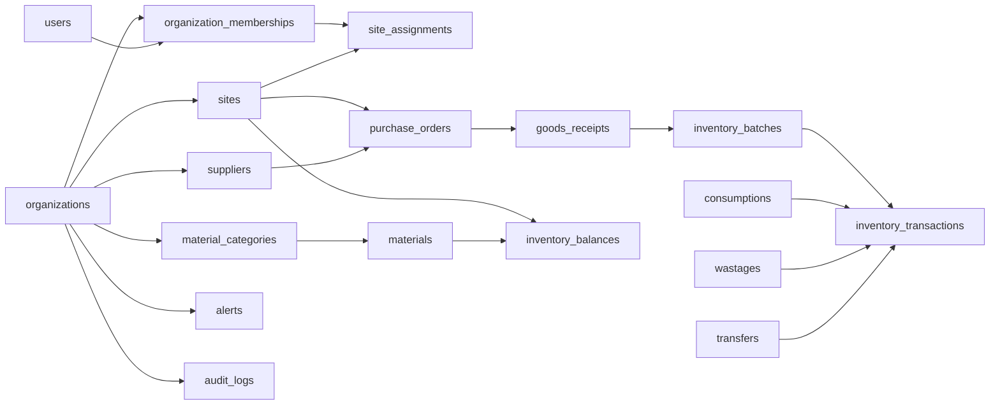

# ConstructStock — Database Design Document

**Version:** 1.0  
**Database:** MongoDB Atlas  
**Application Architecture:** Full-stack Next.js modular monolith  
**Tenant Model:** Shared database/shared collections with `organizationId` isolation  
**Status:** Baseline design

## 1. Purpose
This document defines the MongoDB data model for ConstructStock, a multi-company construction inventory SaaS. It translates the approved product and system architecture into concrete collections, relationships, indexes, validation rules, transaction boundaries, inventory invariants, tenancy rules, and data lifecycle policies.

## 2. Design Principles
- Every tenant-owned business document carries `organizationId` and all repository queries are tenant-scoped.
- Inventory history is append-only: no stock change occurs without one or more `inventory_transactions` ledger records.
- `inventory_balances` is the optimized current-state read model; `inventory_transactions` is the historical source of truth.
- Batch-level stock is retained for FIFO allocation and historical unit cost.
- Critical multi-document workflows use MongoDB transactions so partial stock updates cannot commit.
- Master data is soft-deleted/archived; transactional history is reversed or cancelled instead of deleted.
- Bounded child data is embedded; independent entities and unbounded history are referenced.
- Monetary amounts and quantities use precise decimal representation (MongoDB `Decimal128`), not binary floating point.
- Important business indexes are tenant-aware and usually begin with `organizationId`.
- Critical mutation endpoints support idempotency to prevent duplicate stock changes from retries/double submission.

## 3. Logical Relationship Overview


## 4. Collection Catalogue
- `users`
- `organizations`
- `organization_memberships`
- `site_assignments`
- `sessions`
- `user_invitations`
- `password_reset_tokens`
- `sites`
- `material_categories`
- `materials`
- `suppliers`
- `purchase_orders`
- `goods_receipts`
- `inventory_batches`
- `inventory_balances`
- `inventory_transactions`
- `consumptions`
- `wastages`
- `transfers`
- `alerts`
- `audit_logs`
- `idempotency_keys`
- `auth_rate_limits` (security infrastructure; expiring per-action counters)

## 5. Collection Schemas
### 5.1 `users`

| Field | Type | Required | Purpose |
|---|---|---:|---|
| `_id` | `ObjectId` | Yes | Global user identity. |
| `name` | `string` | Yes | Display/full name. |
| `email` | `string` | Yes | Normalized login email; globally unique. |
| `passwordHash` | `string` | Yes | Argon2id password hash. |
| `status` | `enum` | Yes | ACTIVE, INACTIVE, LOCKED. |
| `createdAt / updatedAt` | `date` | Yes | System timestamps. |
| `deletedAt / deletedBy` | `date/ObjectId | null` | No | Soft-deletion metadata. |

### 5.2 `organizations`

| Field | Type | Required | Purpose |
|---|---|---:|---|
| `_id` | `ObjectId` | Yes | Tenant/company identifier. |
| `name` | `string` | Yes | Construction company name. |
| `slug` | `string` | Yes | Globally unique human-readable slug. |
| `currencyCode` | `string` | Yes | Organization ISO 4217 currency code. |
| `status` | `enum` | Yes | ACTIVE, SUSPENDED, DISABLED. |
| `createdBy` | `ObjectId` | Yes | Owner who registered company. |
| `createdAt / updatedAt` | `date` | Yes | System timestamps. |
| `deletedAt / deletedBy` | `date/ObjectId | null` | No | Soft-deletion metadata. |

### 5.3 `organization_memberships`

| Field | Type | Required | Purpose |
|---|---|---:|---|
| `organizationId` | `ObjectId` | Yes | Tenant reference. |
| `userId` | `ObjectId` | Yes | User reference. |
| `role` | `enum` | Yes | OWNER, ADMIN, SITE_MANAGER, STOREKEEPER. |
| `status` | `enum` | Yes | ACTIVE, INACTIVE, INVITED. |
| `joinedAt` | `date | null` | No | Membership activation date. |
| `createdAt / updatedAt` | `date` | Yes | System timestamps. |

### 5.4 `site_assignments`

| Field | Type | Required | Purpose |
|---|---|---:|---|
| `organizationId` | `ObjectId` | Yes | Tenant reference. |
| `siteId` | `ObjectId` | Yes | Assigned construction site. |
| `userId` | `ObjectId` | Yes | Assigned user. |
| `assignedBy` | `ObjectId` | Yes | Admin/owner who assigned access. |
| `assignedAt` | `date` | Yes | Assignment timestamp. |
| `revokedAt` | `date | null` | No | When assignment ended. |

### 5.5 `sessions`

| Field | Type | Required | Purpose |
|---|---|---:|---|
| `userId` | `ObjectId` | Yes | Authenticated user. |
| `activeOrganizationId` | `ObjectId` | Yes | Membership-validated active tenant for this session. |
| `sessionTokenHash` | `string` | Yes | Hash of opaque session token. |
| `createdAt` | `date` | Yes | Creation time. |
| `expiresAt` | `date` | Yes | Absolute expiry. |
| `lastUsedAt` | `date` | Yes | Most recent activity. |
| `ipAddress` | `string | null` | No | Security metadata. |
| `userAgent` | `string | null` | No | Security/device metadata. |
| `revokedAt` | `date | null` | No | Explicit revocation time. |

### 5.6 `user_invitations`

| Field | Type | Required | Purpose |
|---|---|---:|---|
| `organizationId` | `ObjectId` | Yes | Target tenant. |
| `email` | `string` | Yes | Invited email. |
| `role` | `enum` | Yes | Role granted on acceptance. |
| `siteIds` | `ObjectId[]` | No | Initial site assignments. |
| `tokenHash` | `string` | Yes | Hash of single-use invitation token. |
| `expiresAt` | `date` | Yes | Invitation expiry. |
| `acceptedAt` | `date | null` | No | Acceptance timestamp. |
| `invitedBy` | `ObjectId` | Yes | Owner/admin who invited user. |

### 5.7 `password_reset_tokens`

| Field | Type | Required | Purpose |
|---|---|---:|---|
| `userId` | `ObjectId` | Yes | User requesting reset. |
| `tokenHash` | `string` | Yes | Hashed single-use token. |
| `expiresAt` | `date` | Yes | Token expiry. |
| `usedAt` | `date | null` | No | Consumption timestamp. |

### 5.8 `sites`

| Field | Type | Required | Purpose |
|---|---|---:|---|
| `organizationId` | `ObjectId` | Yes | Tenant reference. |
| `code` | `string` | Yes | Tenant-unique site code. |
| `name` | `string` | Yes | Project/site name. |
| `description` | `string | null` | No | Optional project description. |
| `location` | `object` | Yes | Embedded address/city/state/country. |
| `contact` | `object | null` | No | Optional name/phone/email for the site contact. |
| `status` | `enum` | Yes | PLANNED, ACTIVE, ON_HOLD, COMPLETED, CANCELLED, ARCHIVED. |
| `statusBeforeArchive` | `enum | null` | No | Status restored when the site is unarchived. |
| `startDate` | `date | null` | No | Planned/actual start. |
| `expectedCompletionDate` | `date | null` | No | Expected completion. |
| `budget` | `Decimal128 | null` | No | Optional project budget. |
| `createdBy` | `ObjectId` | Yes | Creator. |
| `createdAt / updatedAt` | `date` | Yes | System timestamps. |
| `deletedAt / deletedBy` | `date/ObjectId | null` | No | Soft-delete metadata. |

### 5.9 `material_categories`

| Field | Type | Required | Purpose |
|---|---|---:|---|
| `organizationId` | `ObjectId` | Yes | Tenant reference. |
| `name` | `string` | Yes | Category name. |
| `nameKey` | `string` | Yes | Tenant-unique normalized category name. |
| `description` | `string | null` | No | Optional description. |
| `status` | `enum` | Yes | ACTIVE, ARCHIVED. |
| `createdAt / updatedAt` | `date` | Yes | System timestamps. |
| `deletedAt` | `date | null` | No | Soft-delete marker. |
| `catalogVersion` | `number` | Yes | Coordinates category archival with material creation/restoration. |

### 5.10 `materials`

| Field | Type | Required | Purpose |
|---|---|---:|---|
| `organizationId` | `ObjectId` | Yes | Tenant reference. |
| `code` | `string` | Yes | Tenant-unique material code. |
| `name` | `string` | Yes | Material name. |
| `description` | `string | null` | No | Optional description. |
| `categoryId` | `ObjectId` | Yes | Category reference. |
| `unit` | `enum` | Yes | BAG, KG, TON, PIECE, LITRE, SQFT, CUBIC_METER, METER. |
| `minimumStockLevel` | `Decimal128` | Yes | Default low-stock threshold. |
| `defaultReorderQuantity` | `Decimal128 | null` | No | Suggested standard reorder amount. |
| `status` | `enum` | Yes | ACTIVE, ARCHIVED. |
| `unitLockedAt` | `date | null` | No | Set in the first inventory transaction to prevent later unit changes. |
| `createdBy` | `ObjectId` | Yes | Creator. |
| `createdAt / updatedAt` | `date` | Yes | System timestamps. |
| `deletedAt / deletedBy` | `date/ObjectId | null` | No | Soft-delete metadata. |

### 5.11 `suppliers`

| Field | Type | Required | Purpose |
|---|---|---:|---|
| `organizationId` | `ObjectId` | Yes | Tenant reference. |
| `code` | `string` | Yes | Tenant-unique supplier code. |
| `name` | `string` | Yes | Supplier name. |
| `contactPerson` | `string | null` | No | Primary contact. |
| `phone / email` | `string | null` | No | Contact details. |
| `address` | `object | null` | No | Embedded address. |
| `gstNumber` | `string | null` | No | Tax identifier where applicable. |
| `paymentTerms` | `string | null` | No | Commercial terms. |
| `status` | `enum` | Yes | ACTIVE, ARCHIVED. |
| `createdBy` | `ObjectId` | Yes | Creator. |
| `createdAt / updatedAt` | `date` | Yes | System timestamps. |
| `deletedAt / deletedBy` | `date/ObjectId | null` | No | Soft-delete metadata. |

### 5.12 `purchase_orders`

| Field | Type | Required | Purpose |
|---|---|---:|---|
| `organizationId` | `ObjectId` | Yes | Tenant reference. |
| `siteId` | `ObjectId` | Yes | Receiving site. |
| `supplierId` | `ObjectId` | Yes | Supplier reference. |
| `poNumber` | `string` | Yes | Tenant-unique PO number. |
| `status` | `enum` | Yes | DRAFT, PENDING_APPROVAL, APPROVED, REJECTED, ORDERED, PARTIALLY_RECEIVED, RECEIVED, CANCELLED. |
| `items` | `array` | Yes | Embedded PO line items. |
| `subtotal / taxTotal / grandTotal` | `Decimal128` | Yes | Commercial totals. |
| `approval` | `object` | Yes | Embedded approval metadata/history summary. |
| `expectedDeliveryDate` | `date | null` | No | Expected delivery date. |
| `createdBy` | `ObjectId` | Yes | Creator. |
| `createdAt / updatedAt` | `date` | Yes | System timestamps. |

### 5.13 `goods_receipts`

| Field | Type | Required | Purpose |
|---|---|---:|---|
| `organizationId` | `ObjectId` | Yes | Tenant reference. |
| `receiptNumber` | `string` | Yes | Tenant-unique GRN number. |
| `purchaseOrderId` | `ObjectId` | Yes | Source PO. |
| `siteId` | `ObjectId` | Yes | Receiving site. |
| `supplierId` | `ObjectId` | Yes | Supplier reference. |
| `receivedAt` | `date` | Yes | Physical receipt time. |
| `items` | `array` | Yes | Embedded received material lines including created batch IDs. |
| `invoiceNumber` | `string | null` | No | Supplier invoice. |
| `deliveryChallanNumber` | `string | null` | No | Delivery reference. |
| `receivedBy` | `ObjectId` | Yes | Storekeeper/site user. |
| `status` | `enum` | Yes | CONFIRMED, REVERSED. |
| `createdAt` | `date` | Yes | Creation timestamp. |

### 5.14 `inventory_batches`

| Field | Type | Required | Purpose |
|---|---|---:|---|
| `organizationId` | `ObjectId` | Yes | Tenant reference. |
| `siteId` | `ObjectId` | Yes | Current site. |
| `materialId` | `ObjectId` | Yes | Material reference. |
| `batchCode` | `string` | Yes | Tenant/site-visible batch identifier. |
| `supplierId` | `ObjectId | null` | No | Original supplier. |
| `goodsReceiptId` | `ObjectId | null` | No | Originating receipt. |
| `sourceTransferId` | `ObjectId | null` | No | Originating transfer for destination-created batches. |
| `sourceBatchId` | `ObjectId | null` | No | Lineage to source batch on transfer. |
| `receivedAt` | `date` | Yes | FIFO ordering timestamp. |
| `initialQuantity` | `Decimal128` | Yes | Quantity entering this batch. |
| `remainingQuantity` | `Decimal128` | Yes | On-hand quantity remaining. |
| `reservedQuantity` | `Decimal128` | Yes | Quantity reserved for approved transfers. |
| `unitCost` | `Decimal128` | Yes | Historical cost per unit. |
| `status` | `enum` | Yes | ACTIVE, DEPLETED, QUARANTINED, REVERSED. |
| `version` | `int` | Yes | Optimistic concurrency revision. |
| `createdAt / updatedAt` | `date` | Yes | System timestamps. |

### 5.15 `inventory_balances`

| Field | Type | Required | Purpose |
|---|---|---:|---|
| `organizationId` | `ObjectId` | Yes | Tenant reference. |
| `siteId` | `ObjectId` | Yes | Site reference. |
| `materialId` | `ObjectId` | Yes | Material reference. |
| `onHandQuantity` | `Decimal128` | Yes | Physical/owned stock at site. |
| `reservedQuantity` | `Decimal128` | Yes | Approved but not yet dispatched transfer quantity. |
| `availableQuantity` | `Decimal128` | Yes | onHand - reserved. |
| `inventoryValue` | `Decimal128` | Yes | Value of remaining batch quantities. |
| `version` | `int` | Yes | Optimistic concurrency revision. |
| `updatedAt` | `date` | Yes | Last balance update. |

### 5.16 `inventory_transactions`

| Field | Type | Required | Purpose |
|---|---|---:|---|
| `organizationId` | `ObjectId` | Yes | Tenant reference. |
| `siteId` | `ObjectId` | Yes | Site affected by entry. |
| `materialId` | `ObjectId` | Yes | Material affected. |
| `batchId` | `ObjectId | null` | No | Batch/cost layer affected. |
| `type` | `enum` | Yes | RECEIPT, CONSUMPTION, WASTAGE, TRANSFER_RESERVE, TRANSFER_RESERVE_RELEASE, TRANSFER_OUT, TRANSFER_IN, ADJUSTMENT_IN, ADJUSTMENT_OUT, REVERSAL. |
| `quantity` | `Decimal128` | Yes | Signed ledger quantity. |
| `unitCost` | `Decimal128 | null` | No | Cost carried by this batch/entry. |
| `referenceType` | `enum` | Yes | Originating business document type. |
| `referenceId` | `ObjectId` | Yes | Originating document. |
| `reversalOfTransactionId` | `ObjectId | null` | No | Original transaction when this is a reversal. |
| `performedBy` | `ObjectId` | Yes | User responsible. |
| `createdAt` | `date` | Yes | Immutable event timestamp. |

### 5.17 `consumptions`

| Field | Type | Required | Purpose |
|---|---|---:|---|
| `organizationId` | `ObjectId` | Yes | Tenant reference. |
| `siteId` | `ObjectId` | Yes | Consuming site. |
| `materialId` | `ObjectId` | Yes | Consumed material. |
| `quantity` | `Decimal128` | Yes | Business quantity requested/issued. |
| `activity` | `string | enum` | No | Construction activity. |
| `issuedTo` | `string | null` | No | Contractor/team/person. |
| `batchAllocations` | `array` | Yes | Embedded batchId + quantity allocations. |
| `allocationMethod` | `enum` | Yes | FIFO or MANUAL. |
| `status` | `enum` | Yes | CONFIRMED, REVERSED. |
| `createdBy` | `ObjectId` | Yes | Creator. |
| `createdAt` | `date` | Yes | Timestamp. |

### 5.18 `wastages`

| Field | Type | Required | Purpose |
|---|---|---:|---|
| `organizationId` | `ObjectId` | Yes | Tenant reference. |
| `siteId` | `ObjectId` | Yes | Site. |
| `materialId` | `ObjectId` | Yes | Material. |
| `quantity` | `Decimal128` | Yes | Wasted quantity. |
| `reason` | `enum` | Yes | BREAKAGE, DAMAGE, TRANSPORT, STORAGE, EXCESS_USAGE, THEFT_LOSS, WEATHER, QUALITY_REJECTION, OTHER. |
| `activity` | `string | null` | No | Related activity. |
| `batchAllocations` | `array` | Yes | Batch quantities deducted. |
| `notes` | `string | null` | No | Explanation. |
| `attachments` | `array` | No | Embedded file metadata. |
| `status` | `enum` | Yes | CONFIRMED, REVERSED. |
| `createdBy` | `ObjectId` | Yes | Creator. |
| `createdAt` | `date` | Yes | Timestamp. |

### 5.19 `transfers`

| Field | Type | Required | Purpose |
|---|---|---:|---|
| `organizationId` | `ObjectId` | Yes | Tenant reference. |
| `transferNumber` | `string` | Yes | Tenant-unique identifier. |
| `sourceSiteId` | `ObjectId` | Yes | Origin site. |
| `destinationSiteId` | `ObjectId` | Yes | Destination site. |
| `materialId` | `ObjectId` | Yes | Material. |
| `quantity` | `Decimal128` | Yes | Requested quantity. |
| `status` | `enum` | Yes | REQUESTED, APPROVED, REJECTED, DISPATCHED, IN_TRANSIT, RECEIVED, CANCELLED. |
| `batchAllocations` | `array` | No | Source batch reservation/allocation. |
| `requestedBy / requestedAt` | `ObjectId/date` | Yes | Request metadata. |
| `approvedBy / approvedAt` | `ObjectId/date | null` | No | Approval metadata. |
| `dispatchedBy / dispatchedAt` | `ObjectId/date | null` | No | Dispatch metadata. |
| `receivedBy / receivedAt` | `ObjectId/date | null` | No | Receipt metadata. |
| `createdAt / updatedAt` | `date` | Yes | System timestamps. |

### 5.20 `alerts`

| Field | Type | Required | Purpose |
|---|---|---:|---|
| `organizationId` | `ObjectId` | Yes | Tenant reference. |
| `type` | `enum` | Yes | LOW_STOCK, OUT_OF_STOCK, DELAYED_PO, HIGH_WASTAGE, TRANSFER_PENDING, etc. |
| `severity` | `enum` | Yes | INFO, WARNING, CRITICAL. |
| `siteId / materialId` | `ObjectId | null` | No | Related inventory scope. |
| `title / message` | `string` | Yes | User-facing content. |
| `status` | `enum` | Yes | OPEN, ACKNOWLEDGED, RESOLVED. |
| `createdAt` | `date` | Yes | Creation time. |
| `resolvedAt` | `date | null` | No | Resolution time. |

### 5.21 `audit_logs`

| Field | Type | Required | Purpose |
|---|---|---:|---|
| `organizationId` | `ObjectId` | Yes | Tenant reference. |
| `actorUserId` | `ObjectId` | Yes | User who performed action. |
| `action` | `string/enum` | Yes | Business/security event. |
| `entityType` | `string/enum` | Yes | Affected entity kind. |
| `entityId` | `ObjectId | string` | Yes | Affected record. |
| `metadata` | `object` | No | Bounded context such as old/new status. |
| `ipAddress` | `string | null` | No | Security context. |
| `createdAt` | `date` | Yes | Immutable event timestamp. |

### 5.22 `idempotency_keys`

| Field | Type | Required | Purpose |
|---|---|---:|---|
| `organizationId` | `ObjectId` | Yes | Tenant reference. |
| `key` | `string` | Yes | Client-supplied idempotency key. |
| `operation` | `string` | Yes | Mutation operation name. |
| `requestHash` | `string` | Yes | Detect conflicting payload reuse. |
| `responseStatus` | `int` | No | Stored result status. |
| `resourceId` | `ObjectId | null` | No | Created/affected resource. |
| `responseBody` | `object | null` | No | Optional bounded response cache. |
| `createdAt` | `date` | Yes | Creation time. |
| `expiresAt` | `date` | Yes | TTL expiry. |

### 5.23 `auth_rate_limits`

| Field | Type | Required | Purpose |
|---|---|---:|---|
| `key` | `string` | Yes | Hashed action/identifier/window key. |
| `count` | `int` | Yes | Attempts within the current window. |
| `expiresAt` | `date` | Yes | TTL expiry after the rate-limit window. |

## 6. Embedded Structures
### Purchase order item
```json
{
  "materialId": "ObjectId",
  "descriptionSnapshot": "OPC 53 Grade Cement",
  "unitSnapshot": "BAG",
  "quantityOrdered": "Decimal128",
  "quantityReceived": "Decimal128",
  "unitPrice": "Decimal128",
  "taxRate": "Decimal128",
  "lineTotal": "Decimal128"
}
```
Snapshots preserve the commercial description/unit used at order time even if master data changes later.

### Batch allocation
```json
{
  "batchId": "ObjectId",
  "quantity": "Decimal128",
  "unitCostSnapshot": "Decimal128"
}
```
Used by consumption, wastage and transfer documents. One business operation may allocate quantity across multiple FIFO batches.

### File attachment metadata
```json
{
  "fileKey": "string",
  "fileName": "string",
  "mimeType": "string",
  "size": 123456,
  "uploadedBy": "ObjectId",
  "uploadedAt": "date"
}
```
Binary file content remains in Vercel Blob; MongoDB stores only metadata and references.

## 7. Embedding vs Referencing Rules
| Data | Strategy | Rationale |
|---|---|---|
| PO line items | Embed | Bounded and owned by one PO; usually read together. |
| Goods receipt items | Embed | Bounded receipt snapshot; usually read together. |
| Consumption/wastage/transfer batch allocations | Embed | Bounded allocation details belong to the business operation. |
| Addresses and small settings | Embed | Small, bounded value objects. |
| Sites, materials, suppliers, users | Reference | Independent lifecycle and reused across documents. |
| Inventory transactions | Separate collection | Unbounded append-only history. |
| Audit logs | Separate collection | Unbounded history and different query patterns. |
| Inventory batches | Separate collection | Independent quantities, FIFO ordering, lineage and concurrency. |

## 8. Inventory Invariants
- `availableQuantity = onHandQuantity - reservedQuantity` and neither value may become negative.
- For a batch, `remainingQuantity >= 0`, `reservedQuantity >= 0`, and `reservedQuantity <= remainingQuantity`.
- No confirmed receipt, consumption, wastage, adjustment, dispatch or transfer receipt may change stock without corresponding ledger rows.
- FIFO allocation selects eligible batches ordered by `receivedAt ASC`, then deterministic `_id ASC` as a tie-breaker.
- Manual batch override is permitted only for authorized users and stores `allocationMethod = MANUAL` plus an audit reason.
- `inventory_balances` is updated in the same MongoDB transaction as batch updates and ledger insertion.
- Completed historical ledger rows are immutable. Corrections use compensating `REVERSAL`/adjustment entries.
- Transfers reserve stock on approval, remove source stock on dispatch, and create destination batch stock only on receipt.

## 9. Quantity and Costing Model
ConstructStock uses site + material balances and site-specific inventory batches. Batch cost is retained as `unitCost` and valuation is derived from the remaining quantities of active batches. FIFO determines which historical cost layers leave inventory during consumption, wastage and transfer dispatch. This keeps quantity movement and cost lineage aligned without introducing weighted-average costing in the MVP.

## 10. Critical Transaction Boundaries
### Material receiving
1. Validate PO/site/supplier and idempotency key.
1. Create confirmed goods receipt.
1. Create one or more inventory batches.
1. Increase inventory balance.
1. Insert `RECEIPT` ledger entries.
1. Update PO line `quantityReceived` and overall status.
1. Write audit event.
All steps execute inside a MongoDB transaction; any failure aborts the complete unit of work.

### Consumption
1. Validate tenant/site/permission/idempotency.
1. Atomically verify sufficient available stock.
1. Allocate FIFO batches.
1. Decrease batch remaining quantities.
1. Decrease inventory balance.
1. Create consumption business document.
1. Insert `CONSUMPTION` ledger rows for each batch allocation.
1. Write audit event.
All steps execute inside a MongoDB transaction; any failure aborts the complete unit of work.

### Wastage
1. Validate request and available stock.
1. Allocate selected/FIFO batches.
1. Decrease batch and balance quantities.
1. Create wastage document.
1. Insert `WASTAGE` ledger rows.
1. Write audit event.
All steps execute inside a MongoDB transaction; any failure aborts the complete unit of work.

### Transfer approval
1. Validate source/destination sites and requested quantity.
1. Allocate/reserve FIFO source batches.
1. Increase batch and balance reserved quantities.
1. Update transfer to APPROVED.
1. Insert reserve ledger/audit records.
All steps execute inside a MongoDB transaction; any failure aborts the complete unit of work.

### Transfer dispatch
1. Release reservation while decreasing on-hand source stock.
1. Decrease source batch remaining/reserved quantities.
1. Decrease source balance onHand/reserved/available consistently.
1. Insert `TRANSFER_OUT` ledger rows.
1. Update transfer to DISPATCHED/IN_TRANSIT.
All steps execute inside a MongoDB transaction; any failure aborts the complete unit of work.

### Transfer receipt
1. Create new destination batch(es) preserving source lineage and unit cost.
1. Increase destination balance.
1. Insert `TRANSFER_IN` ledger entries.
1. Mark transfer RECEIVED.
1. Write audit event.
All steps execute inside a MongoDB transaction; any failure aborts the complete unit of work.

## 11. Concurrency Control
Inventory writes use an atomic availability predicate plus a `version` revision where appropriate. A mutation must fail with a domain conflict if another concurrent transaction changes the eligible quantity before commit. The application may retry transient transaction conflicts, but it must never silently oversell stock.

Example predicate conceptually:
```text
organizationId = tenant
siteId = requested site
materialId = requested material
availableQuantity >= requestedQuantity
version = expectedVersion
```

## 12. Index Strategy
| Collection | Index | Type | Purpose |
|---|---|---|---|
| users | email | Unique | Global login identity; normalized lowercase. |
| organizations | slug | Unique | Public/URL company slug. |
| organization_memberships | organizationId + userId | Unique | One membership per user/company. |
| site_assignments | organizationId + siteId + userId | Unique (active) | Prevent duplicate assignment. |
| sessions | sessionTokenHash | Unique | Session lookup. |
| sessions | expiresAt | TTL | Automatic expiry cleanup. |
| auth_rate_limits | key | Unique | Atomic attempt counter per action/identifier/window. |
| auth_rate_limits | expiresAt | TTL | Automatic expiry cleanup. |
| sites | organizationId + code | Unique among active | Tenant-local business code. |
| materials | organizationId + code | Unique among active | Tenant-local material code. |
| suppliers | organizationId + code | Unique among active | Tenant-local supplier code. |
| purchase_orders | organizationId + poNumber | Unique | PO lookup and display. |
| purchase_orders | organizationId + siteId + status + createdAt | Non-unique | Site workflow lists. |
| goods_receipts | organizationId + receiptNumber | Unique | GRN lookup. |
| goods_receipts | organizationId + purchaseOrderId + receivedAt | Non-unique | PO delivery history. |
| inventory_balances | organizationId + siteId + materialId | Unique | Exactly one current balance per site/material. |
| inventory_batches | organizationId + siteId + materialId + receivedAt | Non-unique | FIFO batch selection. |
| inventory_batches | organizationId + siteId + materialId + status + remainingQuantity | Non-unique | Eligible stock query. |
| inventory_transactions | organizationId + siteId + materialId + createdAt | Non-unique | Ledger/history/reporting. |
| inventory_transactions | organizationId + referenceType + referenceId | Non-unique | Trace business document to ledger entries. |
| consumptions | organizationId + siteId + createdAt | Non-unique | Site consumption history. |
| wastages | organizationId + siteId + createdAt | Non-unique | Site wastage history. |
| transfers | organizationId + transferNumber | Unique | Transfer lookup. |
| transfers | organizationId + sourceSiteId + status + createdAt | Non-unique | Outbound transfer queues. |
| transfers | organizationId + destinationSiteId + status + createdAt | Non-unique | Inbound transfer queues. |
| alerts | organizationId + status + severity + createdAt | Non-unique | Open alert center. |
| audit_logs | organizationId + entityType + entityId + createdAt | Non-unique | Entity audit trail. |
| audit_logs | organizationId + actorUserId + createdAt | Non-unique | User activity investigation. |
| idempotency_keys | organizationId + key | Unique | Prevent duplicate critical mutations. |
| idempotency_keys | expiresAt | TTL | Automatic cleanup after retention window. |

Soft-deleted master data should use partial unique indexes where practical so archived records do not unnecessarily block reuse of business codes.

## 13. Tenant Isolation Rules
- The client never controls the trusted tenant identifier; `organizationId` is derived from the authenticated membership/session context.
- Every repository method for tenant-owned data requires an organization context and includes it in the MongoDB filter.
- Cross-document references must belong to the same organization; e.g., a PO cannot reference a supplier from another tenant.
- Site-scoped operations additionally verify the requesting user has an active `site_assignment` unless their role has organization-wide access.
- Indexes, audit records, idempotency keys, alerts and transaction ledgers remain tenant-scoped.
- Platform-level administration is implemented as a separate trusted path and must not reuse customer-facing authorization assumptions.

## 14. Soft Delete, Cancellation and Reversal
| Record class | Examples | Strategy |
|---|---|---|
| Master data | sites, materials, suppliers, categories, users | Archive/soft delete using status + `deletedAt`/`deletedBy`. |
| Workflow documents | purchase orders, transfers | Use explicit workflow states such as CANCELLED or REJECTED. |
| Confirmed inventory documents | goods receipts, consumptions, wastages | Do not delete; reverse/correct with compensating records. |
| Historical ledgers | inventory_transactions, audit_logs | Append-only and immutable through normal application paths. |

Archiving is blocked when doing so would make active business state invalid, e.g. archiving a material with non-zero stock or a site with open transfers/purchase orders.

## 15. Validation and Domain Constraints
- Quantities must be positive in business documents; sign is applied only in the ledger representation.
- Money/quantities use Decimal128 and application-level decimal libraries; JavaScript floating-point arithmetic must not be used for authoritative totals.
- `sourceSiteId != destinationSiteId` for transfers.
- PO receipts cannot exceed ordered quantity without an explicitly authorized over-receipt policy; MVP default is reject.
- Consumption/wastage/transfer dispatch cannot exceed available stock.
- Only APPROVED/ORDERED POs may receive goods.
- Only APPROVED transfers may be dispatched; only DISPATCHED/IN_TRANSIT transfers may be received.
- Codes are normalized (trimmed, uppercase where applicable) before unique validation.
- All server-generated numbers (PO/GRN/transfer/batch codes) are generated tenant-safely and protected by unique indexes.

## 16. Data Lifecycle and Retention
Operational business records are retained for the lifetime of the tenant unless an explicit legal/data-retention policy is introduced. Expiring security data such as sessions, reset tokens and idempotency keys should use TTL indexes. Audit/inventory ledgers are long-lived and should not be TTL-deleted. If a company account is closed, deletion/anonymization must be a deliberate administrative workflow rather than a normal soft-delete cascade.

## 17. Query Patterns
| Use case | Primary collections / keys |
|---|---|
| Site stock table | `inventory_balances` by organizationId + siteId |
| Material batch/FIFO view | `inventory_batches` by organizationId + siteId + materialId + receivedAt |
| Inventory history | `inventory_transactions` by org/site/material/date |
| PO dashboard | `purchase_orders` by org/site/status/date |
| Supplier history | `purchase_orders` + `goods_receipts` by supplierId |
| Monthly consumption | `inventory_transactions` or `consumptions` aggregated by org/site/material/date |
| Wastage analysis | `wastages` / ledger aggregated by reason/material/site |
| Pending transfers | `transfers` by source/destination site + status |
| User audit trail | `audit_logs` by organizationId + actorUserId/date |

## 18. Data Integrity Reconciliation
A scheduled or admin-triggered reconciliation process should be able to recompute expected site/material stock from active batches and/or ledger entries and compare it with `inventory_balances`. Any mismatch is treated as a high-severity data integrity event, logged for investigation, and repaired only through controlled adjustment/rebuild tooling.

## 19. Schema Evolution and Migrations
- Every schema change is deployed through versioned migration scripts kept in source control.
- Backward-compatible additive changes are preferred for zero-downtime deployment.
- Large backfills should be resumable and tenant-batched.
- Documents may carry `schemaVersion` where a collection requires non-trivial historical transformations.
- Indexes are created/removed deliberately through migration/deployment tooling rather than ad hoc production console changes.

## 20. Security Considerations
- Password hashes and raw session secrets never appear in logs or audit metadata.
- Session, reset and invitation tokens are stored hashed where verification by hash is sufficient.
- Sensitive database credentials remain server-only and are provided through deployment secrets.
- Raw MongoDB access is limited to repository/data-access modules; route handlers do not construct arbitrary tenant queries.
- File attachments store object keys/metadata only; access URLs should be signed/authorized at request time when private.
- Audit logs capture significant authorization, approval, stock, user and organization lifecycle events.

## 21. Backup and Recovery Expectations
MongoDB Atlas backup/snapshot configuration should match the chosen production tier. Recovery procedures must be tested, not assumed. Because current balances are derived from transaction history and batches, recovery validation should include reconciliation of `inventory_balances` against ledger/batch state after any restore.

## 22. Testing Strategy
- Schema validation tests for required fields, enums and Decimal128 conversion.
- Tenant-isolation tests proving cross-company IDs cannot be used to read/write another tenant.
- Unique/partial-index tests for business codes and memberships.
- FIFO allocation tests spanning one and multiple batches.
- Concurrent consumption/transfer tests proving stock cannot become negative.
- Rollback tests that intentionally fail mid-transaction and verify no partial state remains.
- Idempotency tests that repeat the same critical request and produce exactly one business effect.
- Reversal tests confirming historical entries remain intact while net stock is corrected.
- Reconciliation tests comparing balances, batches and ledger totals.

## 23. Example Inventory Calculation
```text
Site A / Cement

Batch A: 50 bags @ ₹380
Batch B: 100 bags @ ₹390
Batch C: 200 bags @ ₹400

On hand = 350
Reserved = 40
Available = 310
Inventory value = 50×380 + 100×390 + 200×400 = ₹138,000

Consumption request: 120 bags (FIFO)
Allocation: Batch A 50 + Batch B 70
Remaining: Batch A 0, Batch B 30, Batch C 200
```

## 24. Final Database Rules
1. No tenant-owned query without `organizationId`.
2. No site-scoped mutation without site authorization.
3. No stock mutation without a ledger entry.
4. No negative available stock.
5. No direct editing/deletion of confirmed inventory history.
6. No use of floating-point numbers for authoritative quantity/money calculations.
7. No transfer receipt before dispatch.
8. No goods receipt against an unapproved/unordered PO.
9. No duplicate critical mutation when the same idempotency key is replayed.
10. No archive operation that would orphan active inventory/workflow state.

## 25. Baseline Status
This design is the approved database baseline for ConstructStock MVP. Future capabilities such as multiple storage locations within a site, barcode/QR execution flows, mobile offline synchronization, configurable approval policies, or alternative costing methods should extend this model without weakening the ledger, tenant-isolation, batch-lineage, and immutability principles defined here.
