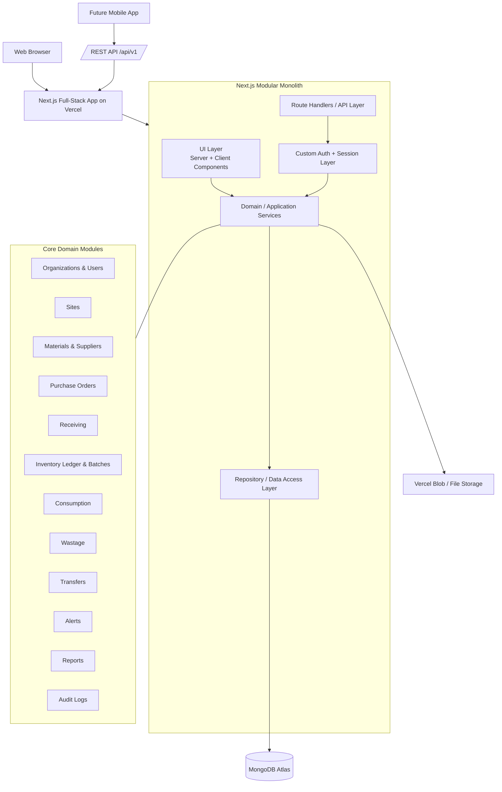
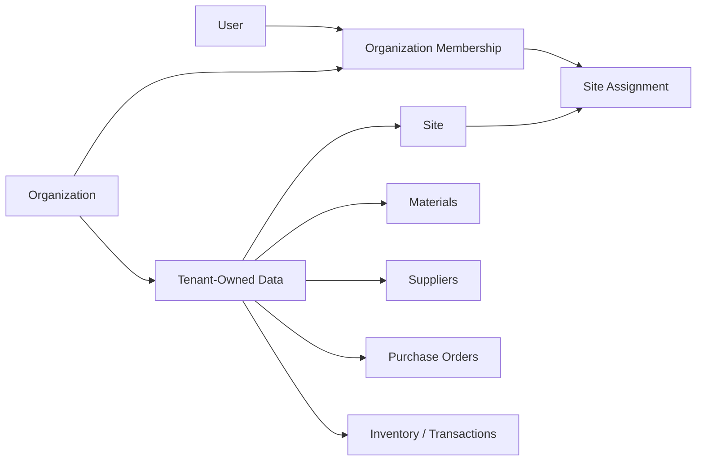
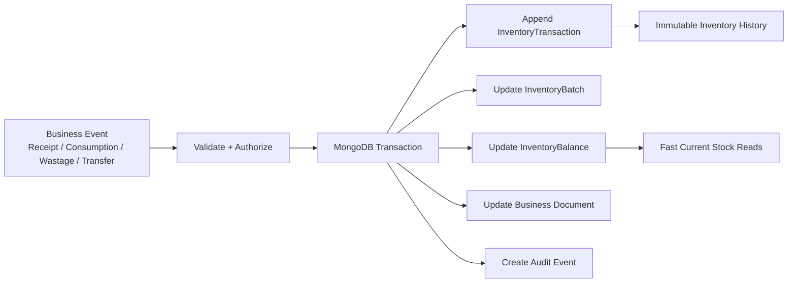
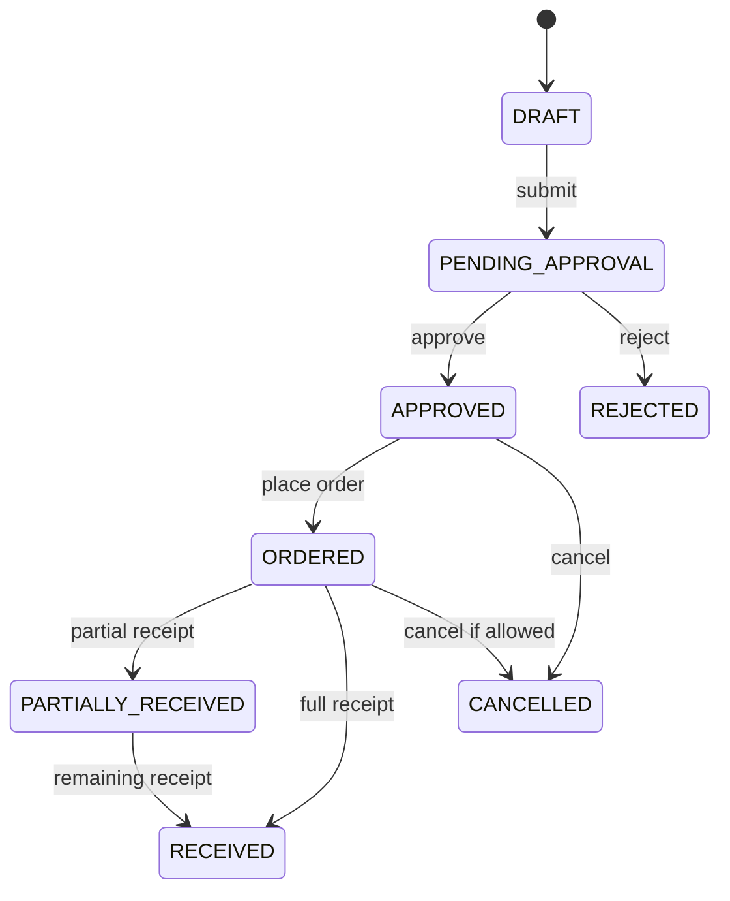
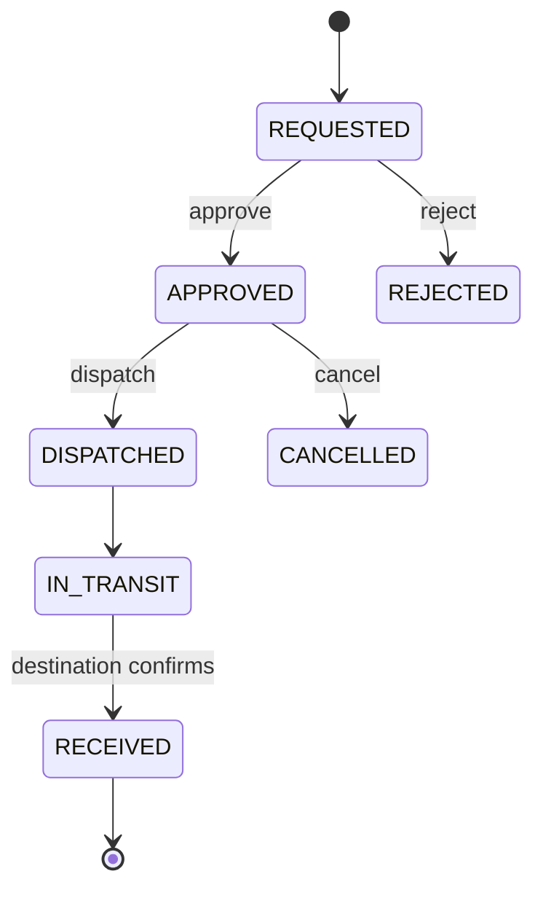
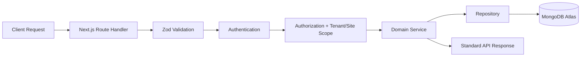

# ConstructStock — System Design Architecture

**Multi-company Construction Material Inventory & Waste Management SaaS**

| **Version**            | 1.0                                       |
|------------------------|-------------------------------------------|
| **Architecture Style** | Modular Monolith                          |
| **Primary Stack**      | Next.js + Node.js runtime + MongoDB Atlas |
| **Deployment**         | Vercel                                    |

> **Note:** Architecture and workflow diagrams are included as Mermaid blocks so this Markdown file is self-contained and renders cleanly in Mermaid-capable viewers.

# Document Purpose and Status

This document defines the target system architecture for ConstructStock based on the finalized product requirements and architecture decisions. It is intended to guide implementation, code organization, data modelling, security, testing, deployment, and future mobile integration.

| **Item**           | **Decision**                                                               |
|--------------------|----------------------------------------------------------------------------|
| Product            | ConstructStock - Construction Material Inventory and Waste Management SaaS |
| Tenant Model       | Multi-company SaaS using shared collections and organizationId isolation   |
| Architecture       | Modular monolith                                                           |
| Frontend + Backend | Full-stack Next.js                                                         |
| API                | Versioned REST API under /api/v1                                           |
| Database           | MongoDB Atlas cluster                                                      |
| Authentication     | Custom authentication with server-side sessions                            |
| Deployment         | Vercel                                                                     |
| Files              | Vercel Blob behind a storage abstraction                                   |
| Billing            | None; service is free                                                      |
| Client Strategy    | Responsive web now; mobile client later                                    |

<table>
<colgroup>
<col style="width: 100%" />
</colgroup>
<thead>
<tr class="header">
<th>
<strong>Architecture status</strong>

Core architecture decisions are considered locked for version 1. Detailed implementation choices may evolve as long as they preserve the principles in this document.
</th>
</tr>
</thead>
<tbody>
</tbody>
</table>

# Contents

1\. Executive Summary

2\. Goals, Scope and Constraints

3\. Architecture Principles

4\. High-Level Architecture

5\. Application Module Boundaries

6\. Multi-Tenant SaaS Design

7\. Identity, Authentication and Session Design

8\. Authorization and Site Access

9\. MongoDB Data Architecture

10\. Inventory Engine and Consistency Model

11\. Core Business Workflows

12\. API Architecture

13\. Files, Reports and Alerts

14\. Security Architecture

15\. Deployment on Vercel

16\. Reliability, Observability and Operations

17\. Performance and Scalability

18\. Failure Scenarios and Recovery

19\. Testing Strategy

20\. Future Mobile Architecture

21\. Architecture Decision Summary

Appendix A. Proposed Collections

Appendix B. Representative REST Endpoints

Appendix C. Standard API Errors

Appendix D. Glossary

# 1. Executive Summary

ConstructStock will be implemented as a multi-tenant, full-stack Next.js modular monolith deployed on Vercel and backed by a MongoDB Atlas cluster. The system will serve multiple construction companies while preserving strict tenant isolation. Each company owns sites, users, materials, suppliers, purchase orders, receipts, inventory, transfers, wastage records, reports, and audit history.

The architecture deliberately avoids microservices for version 1. Business capabilities remain separated as internal modules and services, but they share one codebase, one deployment unit, and one primary database. This reduces operational complexity while preserving enough modularity to extract a service later if a real scaling or ownership requirement appears.

The inventory subsystem is the architectural center of the product. All stock changes must create immutable inventory ledger entries. Current balances are maintained separately for fast reads, batch quantities are tracked for FIFO consumption, approved transfers reserve inventory, and critical multi-document updates execute inside MongoDB transactions. Historical inventory records are corrected using reversal or compensating transactions rather than deletion.

<table>
<colgroup>
<col style="width: 100%" />
</colgroup>
<thead>
<tr class="header">
<th>
<strong>Primary design rule</strong>

No stock change may occur without an InventoryTransaction ledger record. InventoryBalance is a fast current-state projection; the ledger remains the historical source of truth.
</th>
</tr>
</thead>
<tbody>
</tbody>
</table>

# 2. Goals, Scope and Constraints

## 2.1 Architecture Goals

- Keep the first production architecture simple enough for a small team to build and operate.

- Guarantee strong tenant isolation between construction companies.

- Protect inventory correctness under concurrent receiving, consumption, wastage, and transfer operations.

- Preserve complete auditability for stock and approval workflows.

- Expose a stable REST API so a future mobile application can reuse the same backend.

- Allow growth from a college/final-year implementation into a usable SaaS without an early rewrite.

- Keep infrastructure cost and operational overhead low by using Vercel and MongoDB Atlas managed services.

## 2.2 Version 1 Scope

- Organization onboarding and Owner creation.

- Admin-created or invited users.

- Sites/projects and site assignments.

- Material catalogue and material units.

- Supplier management.

- Purchase order creation and single-level approval.

- Partial/full receiving with batch creation.

- Site/material/batch inventory.

- FIFO consumption with authorized manual batch override.

- Wastage recording.

- Approved inter-site transfers with reservation and in-transit state.

- Low-stock and operational alerts.

- Dashboards and reports.

- Audit logging.

- File attachments for invoices, challans, and evidence.

## 2.3 Explicit Non-Goals

- Microservices, event streaming, Kubernetes, or service mesh for version 1.

- Subscriptions, billing, pricing plans, or payment processing.

- Full accounting, payroll, contractor billing, or ERP functionality.

- Dedicated mobile application in version 1.

- Data warehouse or separate analytics database in version 1.

- Redis or a queue unless a demonstrated workload requires background processing.

## 2.4 Constraints and Assumptions

| **Constraint / Assumption** | **Architecture Impact**                                                                                    |
|-----------------------------|------------------------------------------------------------------------------------------------------------|
| Free multi-company SaaS     | No billing domain. Organization lifecycle still supports ACTIVE/SUSPENDED/DISABLED.                        |
| Vercel deployment           | Stateless application instances; sessions and durable state live outside process memory.                   |
| MongoDB Atlas               | Schema and indexes designed for tenant-scoped queries and transactional inventory operations.              |
| Web now, mobile later       | Versioned REST APIs are treated as a supported external interface from day one.                            |
| Custom authentication       | Security-critical session, password, invitation, reset, and revocation flows are owned by the application. |
| Construction-site usage     | Responsive UI and practical low-latency transaction entry are prioritized over desktop-only workflows.     |

# 3. Architecture Principles

| **Principle**                      | **Meaning**                                                                                                                             |
|------------------------------------|-----------------------------------------------------------------------------------------------------------------------------------------|
| P1 - Modular Monolith              | Each major business capability has a service/repository boundary but remains part of one deployable Next.js application.                |
| P2 - Tenant by Construction        | Every tenant-owned record carries organizationId, and every repository query is tenant-scoped.                                          |
| P3 - Server-Derived Tenant Context | organizationId comes from the authenticated membership/session context, not from trusted client input.                                  |
| P4 - Ledger First Inventory        | Every stock mutation creates an immutable InventoryTransaction.                                                                         |
| P5 - Correct Through Compensation  | Historical stock movements are reversed/corrected; they are not edited or deleted.                                                      |
| P6 - Strong Authorization          | Authorization combines membership, permission, organization status, and site assignment.                                                |
| P7 - Transactional Critical Paths  | Receiving, consumption, wastage, dispatch, and receipt of transfers use atomic database transactions where multiple records must agree. |
| P8 - Idempotent Critical Mutations | Duplicate client retries must not create duplicate stock movements.                                                                     |
| P9 - API Stability                 | Domain logic is not tied to UI components. REST endpoints expose stable contracts for future clients.                                   |
| P10 - Managed Infrastructure First | Prefer Vercel, MongoDB Atlas and managed object storage over custom infrastructure until scale requires otherwise.                      |

# 4. High-Level Architecture

*Figure 1. High-level ConstructStock architecture.*

## 4.1 Logical Request Paths

Browser-rendered server components should call domain services directly when executing on the server. They should not make unnecessary HTTP calls back into the application. External clients, browser-side mutations, and the future mobile app use the versioned REST API. Both paths converge on the same domain services and repositories.

<table>
<colgroup>
<col style="width: 100%" />
</colgroup>
<thead>
<tr class="header">
<th>Server-rendered page 
-&gt; Domain Service 
-&gt; Repository 
-&gt; MongoDB Atlas 
 
External/mobile request 
-&gt; /api/v1 Route Handler 
-&gt; validation + auth + authorization 
-&gt; Domain Service 
-&gt; Repository 
-&gt; MongoDB Atlas</th>
</tr>
</thead>
<tbody>
</tbody>
</table>

## 4.2 Runtime Responsibilities

| **Layer**               | **Responsibilities**                                                                          |
|-------------------------|-----------------------------------------------------------------------------------------------|
| UI Layer                | Pages, server/client components, forms, view models, responsive workflows.                    |
| REST API Layer          | HTTP contracts, request parsing, Zod validation, standardized responses, idempotency headers. |
| Auth Layer              | Session validation, CSRF controls, tenant context resolution, role/permission/site checks.    |
| Domain Services         | Business rules, workflow transitions, transaction orchestration, FIFO allocation.             |
| Repository Layer        | Tenant-scoped MongoDB access, queries, indexes, transaction-aware persistence.                |
| Infrastructure Adapters | MongoDB connection, file storage, email sender, logging, optional monitoring integrations.    |

# 5. Application Module Boundaries

| **Module**        | **Responsibility**                                                                      |
|-------------------|-----------------------------------------------------------------------------------------|
| auth              | Registration, login, logout, sessions, email verification, password reset, invitations. |
| organizations     | Company profile, organization status, onboarding, organization-level settings.          |
| users-memberships | Users, memberships, roles, permissions, site assignments.                               |
| sites             | Construction site/project lifecycle and site-level access.                              |
| materials         | Material master, categories, units, reorder thresholds.                                 |
| suppliers         | Supplier master and supplier metadata.                                                  |
| purchasing        | Purchase orders, lines, approval transitions, ordering status.                          |
| receiving         | Goods receipt recording, partial receipt logic, batch creation, PO quantity updates.    |
| inventory         | Balances, batches, ledger transactions, FIFO allocation, reservations, adjustments.     |
| consumption       | Issue/consumption documents and stock deductions by activity/recipient.                 |
| wastage           | Waste/damage/loss records and compensating stock movement.                              |
| transfers         | Request, approval, reservation, dispatch, in-transit and destination receipt.           |
| alerts            | Low-stock, pending approval, delayed delivery, high-wastage and transfer alerts.        |
| reports           | MongoDB aggregation pipelines, filtered operational reporting, exports.                 |
| files             | Vercel Blob adapter and attachment metadata.                                            |
| audit             | Business audit trail for security and operational actions.                              |

## 5.1 Dependency Rule

Route handlers and UI components may call application/domain services. Services may call repositories and infrastructure adapters. Repositories must not contain business workflow logic. Domain services should not depend on Next.js page components. Cross-module behavior should be coordinated through explicit service calls rather than direct writes into another module's collections.

<table>
<colgroup>
<col style="width: 100%" />
</colgroup>
<thead>
<tr class="header">
<th>
<strong>Example</strong>

ReceivingService may call InventoryService to create stock movements and PurchasingService to update received quantities. It should not directly update inventory balance documents in ad hoc code.
</th>
</tr>
</thead>
<tbody>
</tbody>
</table>

# 6. Multi-Tenant SaaS Design

*Figure 2. User, organization membership, site assignment and tenant-owned data relationships.*

## 6.1 Tenant Strategy

ConstructStock uses shared MongoDB collections with tenant-owned documents identified by organizationId. This is appropriate for a free SaaS with many potential organizations and largely identical schemas. It avoids one database per customer while still providing strict logical isolation.

## 6.2 Tenant Context Resolution

1.  Validate the session cookie and resolve the user.

2.  Resolve the active organization membership for the request.

3.  Check that the organization and membership are active.

4.  Attach a server-side RequestContext containing userId, organizationId, role/permissions and site scope.

5.  Pass RequestContext into domain services and repository calls.

6.  Ignore or reject client-supplied organizationId fields for ordinary tenant operations.

## 6.3 Repository Contract

<table>
<colgroup>
<col style="width: 100%" />
</colgroup>
<thead>
<tr class="header">
<th>Unsafe: 
repository.getPurchaseOrder(purchaseOrderId) 
 
Preferred: 
repository.getPurchaseOrder({ 
organizationId: context.organizationId, 
purchaseOrderId 
})</th>
</tr>
</thead>
<tbody>
</tbody>
</table>

## 6.4 Tenant-Aware Indexing

Most uniqueness and query indexes should lead with organizationId. Examples include organizationId + materialCode, organizationId + supplierCode, organizationId + siteId + materialId, and organizationId + purchaseOrderNumber. This both enforces per-tenant uniqueness and improves tenant-scoped query selectivity.

# 7. Identity, Authentication and Session Design

## 7.1 Registration and Onboarding

Public registration creates the first Owner for a new construction company. The registration flow creates the User, Organization, OWNER membership, verification token and initial audit event. The organization should not become fully usable until the owner email is verified.

<table>
<colgroup>
<col style="width: 100%" />
</colgroup>
<thead>
<tr class="header">
<th>Public Signup 
-&gt; create User 
-&gt; create Organization 
-&gt; create OWNER Membership 
-&gt; send verification token 
-&gt; verify email 
-&gt; activate organization/member 
-&gt; dashboard</th>
</tr>
</thead>
<tbody>
</tbody>
</table>

## 7.2 Employee Invitation

Employees do not self-register into an existing organization. An Owner/Admin creates an invitation containing email, intended role and optional site assignments. The invitation is single-use, expires, and allows the recipient to set a password and activate their membership.

## 7.3 Password Security

- Hash passwords with Argon2id using a reviewed library and configured work factor.

- Never store plaintext passwords, reversible encrypted passwords, or password hints.

- Rate-limit login and password-reset attempts.

- Use single-use, expiring tokens for email verification, invitations and password resets.

- Revoke or rotate sessions after password changes and security-sensitive account changes.

## 7.4 Session Model

Web authentication uses opaque server-side sessions. The browser receives a high-entropy session token in a Secure, HttpOnly cookie. Only a hash/verifier of the session token is stored in MongoDB. Session state is therefore durable across stateless Vercel instances and can be revoked centrally.

| **Session Field**     | **Purpose**                                                                  |
|-----------------------|------------------------------------------------------------------------------|
| userId                | Identity owning the session.                                                 |
| sessionTokenHash      | Server-side verifier; raw token is not persisted.                            |
| createdAt / expiresAt | Absolute session lifetime.                                                   |
| lastUsedAt            | Idle-time and activity tracking.                                             |
| ipAddress / userAgent | Security/audit context; avoid treating these as identity.                    |
| revokedAt             | Explicit revocation marker.                                                  |
| organizationContext   | Optional cached current-org choice if multi-org membership is enabled later. |

## 7.5 Cookie and CSRF Controls

- Use Secure + HttpOnly cookies with an appropriate SameSite policy.

- Do not place session tokens in localStorage.

- Protect state-changing cookie-authenticated requests against CSRF using an anti-CSRF mechanism and same-origin checks.

- Rotate session identifiers after authentication and major privilege changes.

- Provide logout for the current session and logout/revoke-all-sessions for the account.

# 8. Authorization and Site Access

## 8.1 Role Model

| **Role**       | **Typical Scope**                                                                                         |
|----------------|-----------------------------------------------------------------------------------------------------------|
| PLATFORM_ADMIN | ConstructStock operator. Organization lifecycle/support only; not ordinary customer inventory operations. |
| OWNER          | Full organization control, user management, approvals, all sites/reports.                                 |
| ADMIN          | Operational administration, users/sites, approvals, organization-wide reports.                            |
| SITE_MANAGER   | Assigned-site inventory visibility, PO creation, transfer requests, site reports.                         |
| STOREKEEPER    | Assigned-site receiving, issuing, wastage entry, transfer handoff/receipt.                                |

## 8.2 Permission-Based Enforcement

Code should authorize permissions such as purchase_order.approve or inventory.consume rather than scattering role-name comparisons throughout the codebase. Roles map to permission sets. Sensitive operations may additionally require site assignment or organization-wide privilege.

| **Permission Example** | **Additional Scope Check**                                            |
|------------------------|-----------------------------------------------------------------------|
| inventory.view         | Assigned site unless Owner/Admin.                                     |
| inventory.consume      | Assigned site and sufficient available stock.                         |
| purchase_order.create  | Assigned site.                                                        |
| purchase_order.approve | Organization-wide approval permission; cannot approve invalid status. |
| transfer.request       | Access to source site.                                                |
| transfer.approve       | Approval permission; may require access to source/destination policy. |
| reports.view           | Organization-wide for Admin/Owner; site-scoped for Site Manager.      |

## 8.3 Authorization Pipeline

<table>
<colgroup>
<col style="width: 100%" />
</colgroup>
<thead>
<tr class="header">
<th>Authenticate session 
-&gt; active user? 
-&gt; active organization? 
-&gt; active membership? 
-&gt; required permission? 
-&gt; site assignment / resource ownership? 
-&gt; resource current state allows action? 
-&gt; ALLOW</th>
</tr>
</thead>
<tbody>
</tbody>
</table>

# 9. MongoDB Data Architecture

## 9.1 Modelling Approach

Use references for independent, long-lived entities and unbounded transaction histories. Embed bounded line-item arrays where they are naturally owned by one aggregate, such as purchase order lines. Avoid embedding unbounded receipts, consumption records, or inventory transactions inside Site or Material documents.

## 9.2 Core Relationship Overview

| **Collection**           | **Key Relationships / Notes**                                                      |
|--------------------------|------------------------------------------------------------------------------------|
| organizations            | Top-level tenant. No tenant-owned business record exists without organizationId.   |
| users                    | Global identity record. Membership controls tenant role/status.                    |
| organization_memberships | userId + organizationId + role + status.                                           |
| site_assignments         | userId + organizationId + siteId; supports scoped access.                          |
| sites                    | Tenant-owned project/site record.                                                  |
| materials                | Tenant-owned material master; category, unit, thresholds.                          |
| suppliers                | Tenant-owned supplier master.                                                      |
| purchase_orders          | Tenant/site/supplier aggregate with embedded bounded line items.                   |
| goods_receipts           | One receipt document per delivery; references PO and site.                         |
| inventory_batches        | Site + material + batch identity, source receipt, remaining quantity.              |
| inventory_balances       | Fast aggregate by organization + site + material.                                  |
| inventory_transactions   | Append-only ledger; one row per batch movement where applicable.                   |
| consumptions             | Business document for issue/use; references generated ledger transactions.         |
| wastages                 | Business document for damage/loss; references generated ledger transactions.       |
| transfers                | Transfer aggregate and status lifecycle; contains requested line items.            |
| alerts                   | Actionable/current alerts; can be regenerated from domain state where appropriate. |
| audit_logs               | Who did what, on which entity, when; immutable operational history.                |
| sessions / auth tokens   | Server-side auth state and expiring security tokens.                               |
| file_attachments         | Blob metadata and linkage to business entities.                                    |

## 9.3 Embed vs Reference Guidance

| **Use Embedding When**                               | **Use References When**                                               |
|------------------------------------------------------|-----------------------------------------------------------------------|
| Child data is bounded and always loaded with parent. | History grows without a practical bound.                              |
| Child lifecycle is fully owned by parent.            | Entity has its own lifecycle or is reused.                            |
| Atomic parent update is useful.                      | Cross-entity lookup/reporting is frequent.                            |
| Example: PO line items.                              | Examples: receipts, inventory transactions, supplier, material, user. |

## 9.4 Soft Delete and Archival

Master data such as sites, materials, suppliers and users/memberships should be archived using status and/or deletedAt/deletedBy fields. Normal repositories automatically exclude archived records unless a privileged administrative query explicitly asks for them.

Transactional records that establish stock or financial history are not soft-deleted in normal operation. Errors are corrected through cancellations, reversals, or compensating transactions so historical truth remains explainable.

## 9.5 Data Retention

Version 1 should retain operational and audit records indefinitely unless a later compliance policy defines deletion. User deactivation must not remove historical attribution. Security tokens and expired sessions may be pruned using TTL indexes where appropriate.

# 10. Inventory Engine and Consistency Model

*Figure 3. Inventory mutation and projection model.*

## 10.1 Core Data Structures

| **Structure**        | **Purpose**                                                                                                                            |
|----------------------|----------------------------------------------------------------------------------------------------------------------------------------|
| InventoryTransaction | Immutable stock movement history. Contains organization, site, material, batch, type, signed quantity, reference, actor and timestamp. |
| InventoryBatch       | Batch-level stock for FIFO/manual allocation, supplier/source receipt, cost and remaining/reserved quantities.                         |
| InventoryBalance     | Fast site/material aggregate: onHand, reserved, available and optionally value/cost metadata.                                          |
| Business Document    | Receipt, consumption, wastage or transfer record explaining why stock moved.                                                           |

## 10.2 Balance Semantics

<table>
<colgroup>
<col style="width: 100%" />
</colgroup>
<thead>
<tr class="header">
<th>On Hand = physical quantity currently owned at the site 
Reserved = quantity committed to approved operations (for example, an approved transfer) 
Available = On Hand - Reserved 
 
Site material balance conceptually reflects: 
Received + TransferIn + PositiveAdjustment 
- Consumption - Wastage - TransferOut - NegativeAdjustment</th>
</tr>
</thead>
<tbody>
</tbody>
</table>

## 10.3 FIFO Consumption

Default consumption allocates quantity against the oldest eligible batch first. If 120 bags are requested and Batch A has 50 while Batch B has 100, the engine creates -50 against Batch A and -70 against Batch B. An authorized user may manually select batches; manual override should record a reason for auditability.

## 10.4 Reservation Model

Approval of a transfer reserves source stock without immediately reducing on-hand quantity. Consumption checks available quantity, not only on-hand quantity. Dispatch converts the reservation into a source stock deduction. This prevents approved commitments from being consumed by another user before dispatch.

## 10.5 Atomic Mutation Algorithm

7.  Validate request, idempotency key, tenant, permission, site scope and business status.

8.  Start a MongoDB session/transaction for workflows requiring multiple dependent writes.

9.  Lock correctness through conditional updates: only deduct/reserve if the current quantity is sufficient.

10. Allocate batch quantities using FIFO or approved manual selection.

11. Create the business document or transition its status.

12. Append one or more InventoryTransaction ledger entries.

13. Update InventoryBatch quantities/reservations.

14. Update InventoryBalance aggregate quantities.

15. Create audit event and update related PO/transfer state as required.

16. Commit. If any step fails, abort the transaction and return a domain-specific error.

## 10.6 Concurrency Protection

Concurrent requests must not rely on an earlier read followed by an unconditional write. Stock mutations use conditional updates inside the transaction so only a request that still satisfies available \>= requested can proceed. A competing request then observes the new balance or fails the condition and returns INSUFFICIENT_STOCK.

## 10.7 Reversal and Corrections

Ledger entries are not edited. A mistaken -100 consumption is corrected by a +100 reversal linked to the original transaction, followed by the correct transaction (for example -10). Reversal metadata includes originalTransactionId, reason, actor, timestamp and business document reference.

# 11. Core Business Workflows

## 11.1 Purchase Order Lifecycle

*Figure 4. Purchase order state machine.*

- DRAFT may be edited by authorized users.

- Submission moves the PO to PENDING_APPROVAL.

- Owner/Admin approval moves it to APPROVED; rejection requires a reason.

- Ordering moves it to ORDERED.

- Receipts update received quantities per line and move status to PARTIALLY_RECEIVED or RECEIVED.

- Invalid transitions are rejected by the service even if a client sends them directly.

## 11.2 Receiving Workflow

<table>
<colgroup>
<col style="width: 100%" />
</colgroup>
<thead>
<tr class="header">
<th>Validate PO is receivable 
-&gt; validate delivered quantities 
-&gt; create GoodsReceipt 
-&gt; create/identify batch(es) 
-&gt; + InventoryTransaction(s) 
-&gt; update InventoryBatch 
-&gt; update InventoryBalance 
-&gt; update PO line received quantities/status 
-&gt; audit 
-&gt; commit</th>
</tr>
</thead>
<tbody>
</tbody>
</table>

## 11.3 Consumption Workflow

<table>
<colgroup>
<col style="width: 100%" />
</colgroup>
<thead>
<tr class="header">
<th>Validate site + permission + idempotency 
-&gt; available stock check 
-&gt; FIFO/manual batch allocation 
-&gt; create Consumption record 
-&gt; - InventoryTransaction(s) 
-&gt; decrement batch quantities 
-&gt; decrement InventoryBalance.onHand 
-&gt; audit 
-&gt; commit</th>
</tr>
</thead>
<tbody>
</tbody>
</table>

## 11.4 Wastage Workflow

Wastage follows the same stock integrity rules as consumption but captures reason, construction activity, optional evidence, and waste-specific analytics. It cannot drive available stock below zero.

## 11.5 Inter-Site Transfer Lifecycle

*Figure 5. Transfer state machine and stock effects.*

| **Transition**                     | **Stock Effect**                                                          |
|------------------------------------|---------------------------------------------------------------------------|
| REQUESTED                          | No stock movement.                                                        |
| APPROVED                           | Reserve source quantity; available decreases, on-hand unchanged.          |
| DISPATCHED                         | Release reservation and reduce source on-hand; goods become in-transit.   |
| IN_TRANSIT                         | No additional site stock change.                                          |
| RECEIVED                           | Increase destination batch/balance and create transfer-in ledger entries. |
| REJECTED/CANCELLED before dispatch | Release any reservation if already approved.                              |

## 11.6 Low Stock Alerts

After successful stock mutations, the service evaluates current available quantity against the configured site/material threshold. An alert is created or updated when below threshold and automatically resolved when stock recovers. Alert creation should be idempotent to avoid duplicate active alerts for the same site/material condition.

# 12. API Architecture

*Figure 6. Standard REST API request lifecycle.*

## 12.1 API Conventions

- Base path: /api/v1.

- JSON request/response for business APIs.

- Zod validates payloads, path/query parameters and expected enums.

- Route handlers remain thin and delegate business logic to services.

- Use nouns/resources for URLs and explicit action endpoints only for workflow transitions where appropriate.

- Pagination is required for unbounded lists and transaction history.

- Filtering always remains tenant-scoped server-side.

- Critical mutation endpoints accept an Idempotency-Key header.

## 12.2 Standard Response Envelope

<table>
<colgroup>
<col style="width: 100%" />
</colgroup>
<thead>
<tr class="header">
<th>Success 
{ 
"success": true, 
"data": { ... } 
} 
 
Failure 
{ 
"success": false, 
"error": { 
"code": "INSUFFICIENT_STOCK", 
"message": "Only 75 cement bags are currently available.", 
"details": { ... } 
}, 
"requestId": "..." 
}</th>
</tr>
</thead>
<tbody>
</tbody>
</table>

## 12.3 Idempotency

Receiving, consumption, wastage, transfer dispatch/receipt and other stock-affecting writes should accept a client-generated Idempotency-Key. The server stores the key, tenant, operation fingerprint and result. A replay of the same operation returns the prior result rather than executing stock movement again. Reuse of the same key with a conflicting payload returns an idempotency conflict.

## 12.4 Pagination and Filtering

List endpoints use deterministic sorting and either cursor-based pagination for high-volume histories or page/limit for smaller administrative lists. Filters include site, material, supplier, status and date range. No filter can broaden the request outside the authenticated tenant/site scope.

## 12.5 Versioning

Breaking public API changes require a new version path. Internal service refactoring does not require an API version change. The initial mobile app should target /api/v1 so web and mobile remain aligned.

# 13. Files, Reports and Alerts

## 13.1 File Storage

Invoices, delivery challans, wastage photos and other binary files are stored in Vercel Blob through a FileStorageService abstraction. MongoDB stores attachment metadata, ownership, MIME type, size, storage key/URL, related entity, uploader and timestamps. This prevents database documents from becoming binary storage containers and allows a later move to S3 without changing domain code.

## 13.2 Upload Security

- Allowlisted MIME types and extensions.

- File size limits by attachment category.

- Randomized storage keys rather than user-provided paths.

- Authorization before creating upload credentials or accepting links.

- Do not trust client MIME declarations alone; validate server-side where practical.

- Future antivirus scanning can be introduced behind the storage abstraction.

## 13.3 Reporting

Version 1 reports use MongoDB aggregation pipelines over operational collections and inventory projections. Common reports include current stock, inventory value, purchase history, consumption, wastage, supplier spend and site summaries. Expensive recurring aggregates may later be materialized into summary collections, but a separate warehouse is not required initially.

## 13.4 Exports

Small to medium PDF/Excel exports may be generated synchronously. If exports become large enough to exceed comfortable request execution, introduce a background-job mechanism rather than blocking normal API requests. The job interface should be added only when actual workload justifies it.

## 13.5 Alerts

Alerts are tenant-owned actionable records generated from domain events/state: low stock, out of stock, pending PO approval, delayed delivery, pending transfer approval, or abnormal wastage. Active alerts should have a deterministic uniqueness key so repeated stock updates do not create duplicate unresolved alerts.

# 14. Security Architecture

| **Control Area** | **Design**                                                                                             |
|------------------|--------------------------------------------------------------------------------------------------------|
| Password storage | Argon2id hashes; no reversible password storage.                                                       |
| Sessions         | Opaque high-entropy tokens; HttpOnly/Secure cookie; server-side hashed verifier; revocation supported. |
| CSRF             | Protect state-changing cookie-authenticated routes; enforce origin/same-site policy.                   |
| Authorization    | Membership + permission + site assignment + resource state checks on server.                           |
| Tenant isolation | organizationId resolved from session/membership and applied in every tenant repository query.          |
| Validation       | Zod validation at API boundary; domain-level invariants inside services.                               |
| Rate limiting    | Login, reset, invitation acceptance and abuse-sensitive endpoints.                                     |
| Secrets          | Vercel environment variables; never committed to source.                                               |
| Audit            | Record authentication/security changes and business-sensitive actions.                                 |
| Soft delete      | Master data archived; transaction history preserved.                                                   |
| Files            | Restricted upload types/sizes; authorization around attachment access.                                 |
| Transport        | HTTPS only in production.                                                                              |

## 14.1 Security Boundaries

The frontend is not a trust boundary. Hidden buttons do not provide authorization. Every API/service operation independently validates server-side identity, tenant, permission and site scope. Object IDs are treated as untrusted input and must always be resolved under tenant scope.

## 14.2 Platform Admin

PLATFORM_ADMIN is reserved for ConstructStock operational administration. Access should be separately guarded and audited. Platform staff should not silently act as customer users. Any future support impersonation feature would require explicit, highly visible audit records and is not in version 1.

# 15. Deployment on Vercel

## 15.1 Topology

<table>
<colgroup>
<col style="width: 100%" />
</colgroup>
<thead>
<tr class="header">
<th>Git repository 
-&gt; Vercel build/deploy 
-&gt; Next.js application 
-&gt; MongoDB Atlas 
-&gt; Vercel Blob 
-&gt; Email provider (adapter) 
-&gt; Vercel logs / optional Sentry</th>
</tr>
</thead>
<tbody>
</tbody>
</table>

## 15.2 Environments

| **Environment** | **Purpose**                                                                      |
|-----------------|----------------------------------------------------------------------------------|
| Local           | Developer machines; local/test MongoDB configuration as appropriate.             |
| Preview         | Vercel preview deployment per branch/PR; isolated or protected test data.        |
| Production      | Customer-facing Vercel project connected to production Atlas and Blob resources. |

## 15.3 MongoDB Connection Management

The application uses a cached/shared MongoClient/Mongoose connection per warm runtime rather than creating a new client for every query. Connection pool settings should be conservative and reviewed against the Atlas cluster tier because serverless traffic can create many concurrent runtime instances.

## 15.4 Environment Configuration

- MONGODB_URI and database name.

- Session signing/secret material and token-pepper secret if used.

- Email provider credentials.

- Vercel Blob credentials/configuration.

- Public application URL and allowed origins.

- Monitoring DSN in environments where enabled.

## 15.5 Migration and Index Management

Even with MongoDB, schema/index changes require controlled rollout. Maintain idempotent migration scripts for backfills, new required fields, index creation and state normalization. Avoid relying only on runtime Mongoose auto-indexing in production.

# 16. Reliability, Observability and Operations

## 16.1 Structured Logging

Application logs should be structured and include requestId, route, status, duration, environment and non-sensitive tenant/entity identifiers where useful. Never log passwords, session tokens, reset tokens or full sensitive request bodies.

## 16.2 Audit Logging

Audit logs are business/security records, not developer logs. Typical audit events include user invited, role changed, PO approved/rejected, material received, consumption posted, wastage recorded, transfer approved/dispatched/received, master record archived, password changed and sessions revoked.

## 16.3 Monitoring

- Vercel request/function logs for operational visibility.

- Optional Sentry integration for uncaught exceptions, traces and release correlation.

- MongoDB Atlas monitoring for connections, slow queries, CPU/memory/storage and replication health.

- Application-level metrics can be added later for transaction failure rates, stock conflicts and report latency.

## 16.4 Backup and Restore

Enable MongoDB Atlas backup capability appropriate to the selected cluster. Define a recovery procedure that restores into a separate environment first, validates tenant and ledger integrity, and then promotes or selectively recovers data. Vercel Blob/object storage retention should be configured independently because database backup does not include binary files.

## 16.5 Operational Runbooks

- Unable to connect to MongoDB / connection saturation.

- Failed or timed-out inventory transaction.

- Duplicate client submission / idempotency conflict.

- Incorrect stock requiring reversal.

- Organization suspension/reactivation.

- Account compromise and session revocation.

- Failed file upload.

- Large report timeout or memory issue.

# 17. Performance and Scalability

## 17.1 Expected Scaling Pattern

Early scale is expected to come from more companies, more sites and longer transaction history rather than extreme single-tenant throughput. Shared collections with organizationId-prefixed indexes support this pattern while the modular monolith keeps application deployment simple.

## 17.2 Query/Index Priorities

| **Query Pattern**            | **Representative Index Direction**                                    |
|------------------------------|-----------------------------------------------------------------------|
| Site inventory list          | organizationId + siteId + materialId                                  |
| Material transaction history | organizationId + siteId + materialId + createdAt                      |
| Batch FIFO selection         | organizationId + siteId + materialId + receivedAt + remainingQty      |
| PO lists by status/date      | organizationId + siteId + status + createdAt                          |
| Supplier purchase history    | organizationId + supplierId + createdAt                               |
| Active alerts                | organizationId + status + type + siteId                               |
| Membership lookup            | organizationId + userId / userId + status                             |
| Unique codes                 | organizationId + code with active/partial uniqueness where applicable |

## 17.3 Caching

Do not introduce Redis in version 1. Use normal HTTP/Next.js caching carefully only for data whose freshness semantics permit it. Inventory balances, approval state and user authorization should default to fresh server reads. If dashboard aggregation becomes expensive, add targeted short-lived caching or pre-aggregated summary collections after measurement.

## 17.4 Growth Path

17. Optimize indexes and aggregation pipelines.

18. Add summary/materialized collections for expensive dashboards.

19. Introduce background jobs for large exports/notifications.

20. Add selective cache for read-heavy derived data.

21. Scale Atlas tier and evaluate sharding only when dataset/throughput requires it.

22. Extract a module into a separate service only when independent scaling or team ownership makes the operational cost worthwhile.

# 18. Failure Scenarios and Recovery

| **Scenario**                                      | **Expected Behaviour / Recovery**                                                                     |
|---------------------------------------------------|-------------------------------------------------------------------------------------------------------|
| Duplicate Receive click/retry                     | Same Idempotency-Key returns the original result; no duplicate stock.                                 |
| Two users consume same limited stock              | Conditional transactional update allows only valid quantity; loser gets INSUFFICIENT_STOCK.           |
| Failure halfway through receiving                 | MongoDB transaction aborts; PO, batch, ledger and balance remain consistent.                          |
| Transfer approved then cancelled                  | Release reservation; audit cancellation.                                                              |
| Dispatch succeeds but destination receipt delayed | Quantity remains explicitly in transit; source is already reduced, destination not yet increased.     |
| Incorrect completed consumption                   | Create reversal transaction, then correct consumption. Do not edit ledger history.                    |
| User disabled while sessions active               | Mark membership/user inactive and revoke sessions; subsequent requests fail authorization.            |
| Organization suspended                            | Block tenant operations while retaining data and audit history.                                       |
| File upload fails after business save             | Attachment remains absent/failed; retry upload independently. Avoid corrupting inventory transaction. |
| Report aggregation times out                      | Return controlled failure; optimize or move to async export if repeated.                              |
| Atlas unavailable                                 | Fail requests without local fallback writes; retry only safe/idempotent reads or writes.              |
| Vercel instance restarts                          | No loss of session/domain state because durable state is external.                                    |

# 19. Testing Strategy

## 19.1 Unit Tests

- FIFO allocation algorithm.

- PO and transfer state transition guards.

- Permission mapping and site access checks.

- Balance calculations.

- Reversal rules.

- Validation and domain error mapping.

## 19.2 Integration Tests

- Receiving updates receipt + batch + ledger + balance + PO atomically.

- Concurrent consumption cannot oversell available stock.

- Approved transfer reserves stock and dispatch/receipt move quantity correctly.

- Tenant A cannot read or mutate Tenant B resources even with valid IDs.

- Soft-deleted master records disappear from normal queries but historical references remain valid.

- Idempotency replays return prior results rather than repeating stock movement.

## 19.3 API / E2E Tests

- Owner registration and email verification.

- Admin invitation and employee activation.

- Role/site access paths.

- PO approval and partial receiving.

- Consumption, wastage, transfer workflows.

- Dashboard/report filters.

- Session expiry, logout and revoke-all.

## 19.4 Security Tests

- Cross-tenant object ID access.

- Broken site authorization.

- CSRF on state-changing endpoints.

- Session fixation/rotation checks.

- Brute-force/rate-limit checks.

- Token replay after invitation/reset use.

- Malformed file uploads.

# 20. Future Mobile Architecture

The mobile application will not require a new backend. It will authenticate against the same API contract and consume /api/v1 resources. The mobile client should not depend on Next.js server components or internal service implementation details.

## 20.1 Mobile Authentication Consideration

Browser sessions use Secure HttpOnly cookies. A native mobile application may require a separate secure token/session transport while reusing the same SessionService and user/membership model. The API should therefore keep authentication concerns behind middleware/context rather than embedding cookie assumptions into domain services.

## 20.2 Offline Future

Construction sites may eventually need limited offline entry. If introduced, offline mutations must carry stable client-generated operation IDs/idempotency keys and synchronize through conflict-aware server APIs. Offline mode is explicitly outside version 1, but the idempotent mutation design improves future feasibility.

# 21. Architecture Decision Summary

| **Decision Area**     | **Selected Option**                            | **Rationale**                                                                   |
|-----------------------|------------------------------------------------|---------------------------------------------------------------------------------|
| Architecture style    | Modular monolith                               | Low operational overhead; clear internal modules; future extraction possible.   |
| Application framework | Full-stack Next.js                             | Single codebase for web and API; matches team preference and Vercel deployment. |
| API                   | REST /api/v1                                   | Simple transactional domain; future mobile compatibility.                       |
| Database              | MongoDB Atlas                                  | Document-friendly aggregates, managed availability, transactions, growth path.  |
| Tenancy               | Shared collections + organizationId            | Efficient for many free tenants with common schema.                             |
| Auth                  | Custom server-side sessions                    | Full control; browser-safe opaque session model.                                |
| Authorization         | RBAC permissions + site assignment             | Matches organization and site-scoped responsibilities.                          |
| Inventory history     | Append-only ledger                             | Auditability and reliable corrections.                                          |
| Current stock         | InventoryBalance + InventoryBatch              | Fast reads plus batch/FIFO precision.                                           |
| Batch allocation      | FIFO default + manual override                 | Practical material usage and QR-ready batch model.                              |
| Transfers             | Approval + reserve + dispatch + receive        | Prevents double allocation and models in-transit stock.                         |
| Deletion              | Soft/archive master data; reverse transactions | Preserve historical attribution and stock truth.                                |
| Files                 | Vercel Blob abstraction                        | Simple deployment now; provider can change later.                               |
| Caching               | No Redis initially                             | Avoid unnecessary infrastructure; measure first.                                |
| Deployment            | Vercel                                         | Managed Next.js hosting with preview environments.                              |
| Billing               | None                                           | Product is free; no subscription domain.                                        |

# Appendix A. Proposed Collections

| **Collection**           | **Representative Fields / Notes**                                                                                        |
|--------------------------|--------------------------------------------------------------------------------------------------------------------------|
| organizations            | \_id, name, slug, status, createdBy, settings, createdAt, updatedAt                                                      |
| users                    | \_id, name, email, emailVerifiedAt, passwordHash, status, createdAt, updatedAt                                           |
| organization_memberships | \_id, organizationId, userId, role, status, invitedBy, joinedAt                                                          |
| site_assignments         | \_id, organizationId, siteId, userId, accessRole/status                                                                  |
| sessions                 | \_id, userId, sessionTokenHash, expiresAt, lastUsedAt, revokedAt, ip/userAgent                                           |
| auth_tokens              | verification/invitation/reset token hash, purpose, expiry, usedAt                                                        |
| sites                    | \_id, organizationId, code, name, location, dates, status, manager refs, deletedAt                                       |
| materials                | \_id, organizationId, code, name, category, unit, reorder settings, status/deletedAt                                     |
| suppliers                | \_id, organizationId, code, contact/tax/payment info, status/deletedAt                                                   |
| purchase_orders          | \_id, organizationId, siteId, supplierId, poNumber, lines\[\], status, approval history, totals                          |
| goods_receipts           | \_id, organizationId, siteId, supplierId, purchaseOrderId, receiptNo, lines\[\], files, createdBy                        |
| inventory_batches        | \_id, organizationId, siteId, materialId, batchCode, receiptId, supplierId, receivedAt, onHand/reserved, unitCost        |
| inventory_balances       | \_id, organizationId, siteId, materialId, onHand, reserved, available, updatedAt/version                                 |
| inventory_transactions   | \_id, organizationId, siteId, materialId, batchId, type, signedQty, referenceType/id, reversalOf, actor, createdAt       |
| consumptions             | \_id, organizationId, siteId, number, lines/allocations, activity, issuedTo, status, createdBy                           |
| wastages                 | \_id, organizationId, siteId, number, lines/allocations, reason, activity, evidence, createdBy                           |
| transfers                | \_id, organizationId, sourceSiteId, destinationSiteId, transferNo, lines\[\], status, approval/dispatch/receipt metadata |
| alerts                   | \_id, organizationId, siteId, type, severity, entity refs, status, uniquenessKey, createdAt/resolvedAt                   |
| audit_logs               | \_id, organizationId, userId, action, entityType/id, before/after summary, requestId, timestamp                          |
| file_attachments         | \_id, organizationId, storageKey/url, fileName, mimeType, size, entityType/id, uploadedBy                                |
| idempotency_records      | \_id, organizationId, key, operation, requestHash, response snapshot/reference, status, expiresAt                        |

# Appendix B. Representative REST Endpoints

| **Method** | **Endpoint**                           | **Purpose**                            |
|------------|----------------------------------------|----------------------------------------|
| POST       | /api/v1/auth/register                  | Create organization + first Owner.     |
| POST       | /api/v1/auth/login                     | Create server session.                 |
| POST       | /api/v1/auth/logout                    | Revoke current session.                |
| POST       | /api/v1/auth/invitations               | Invite employee.                       |
| POST       | /api/v1/auth/invitations/:token/accept | Accept invitation and set password.    |
| GET/POST   | /api/v1/sites                          | List/create sites.                     |
| GET/PATCH  | /api/v1/sites/:siteId                  | Read/update/archive site.              |
| GET/POST   | /api/v1/materials                      | Material catalogue.                    |
| GET/POST   | /api/v1/suppliers                      | Supplier catalogue.                    |
| GET/POST   | /api/v1/purchase-orders                | List/create purchase orders.           |
| POST       | /api/v1/purchase-orders/:id/submit     | Submit for approval.                   |
| POST       | /api/v1/purchase-orders/:id/approve    | Approve PO.                            |
| POST       | /api/v1/purchase-orders/:id/reject     | Reject PO.                             |
| POST       | /api/v1/goods-receipts                 | Record delivery; stock-in transaction. |
| GET        | /api/v1/sites/:siteId/inventory        | Current site inventory.                |
| GET        | /api/v1/inventory/transactions         | Ledger/history filters.                |
| POST       | /api/v1/consumptions                   | Issue/consume materials.               |
| POST       | /api/v1/wastages                       | Record material wastage.               |
| GET/POST   | /api/v1/transfers                      | List/request transfer.                 |
| POST       | /api/v1/transfers/:id/approve          | Approve and reserve stock.             |
| POST       | /api/v1/transfers/:id/dispatch         | Dispatch and deduct source.            |
| POST       | /api/v1/transfers/:id/receive          | Receive at destination.                |
| GET        | /api/v1/alerts                         | Active/history alerts.                 |
| GET        | /api/v1/reports/inventory              | Inventory report.                      |
| GET        | /api/v1/reports/consumption            | Consumption report.                    |
| GET        | /api/v1/reports/wastage                | Wastage report.                        |
| GET        | /api/v1/reports/purchases              | Purchase report.                       |

# Appendix C. Standard API Errors

| **Code**                  | **Meaning**                                                        |
|---------------------------|--------------------------------------------------------------------|
| UNAUTHORIZED              | No valid session.                                                  |
| FORBIDDEN                 | Authenticated but permission is missing.                           |
| TENANT_ACCESS_DENIED      | Resource is outside current tenant.                                |
| SITE_ACCESS_DENIED        | User is not assigned/authorized for the site.                      |
| VALIDATION_ERROR          | Request shape or value invalid.                                    |
| RESOURCE_NOT_FOUND        | Tenant-scoped resource does not exist.                             |
| CONFLICT                  | Concurrent or state conflict.                                      |
| INVALID_STATUS_TRANSITION | Workflow action is not valid for current state.                    |
| INSUFFICIENT_STOCK        | Available stock is lower than requested quantity.                  |
| BATCH_NOT_AVAILABLE       | Requested/manual batch cannot satisfy allocation.                  |
| IDEMPOTENCY_CONFLICT      | Same idempotency key reused with a different request.              |
| MATERIAL_HAS_ACTIVE_STOCK | Archive/delete request rejected because stock remains.             |
| OPEN_DEPENDENCIES         | Archive action blocked by open PO/transfer/inventory dependencies. |
| INTERNAL_ERROR            | Unexpected server failure; requestId returned for diagnosis.       |

# Appendix D. Glossary

| **Term**                 | **Definition**                                                                                |
|--------------------------|-----------------------------------------------------------------------------------------------|
| Tenant                   | A construction company/Organization using ConstructStock.                                     |
| Organization             | Top-level SaaS customer boundary.                                                             |
| Site                     | A construction project/location within an organization.                                       |
| Material                 | Tenant-defined inventory item such as cement, steel, sand or tiles.                           |
| Batch                    | A received lot of one material at one site, traceable to a receipt/supplier.                  |
| On Hand                  | Physical quantity currently owned at a site.                                                  |
| Reserved                 | On-hand quantity committed to an approved operation and not available for normal consumption. |
| Available                | On Hand minus Reserved.                                                                       |
| Inventory Transaction    | Append-only ledger entry describing a signed stock movement.                                  |
| FIFO                     | First-In, First-Out batch allocation: oldest eligible stock is consumed first.                |
| Goods Receipt            | Business record confirming delivered materials and increasing inventory.                      |
| Compensating Transaction | New transaction that reverses/corrects the effect of an earlier transaction.                  |
| Idempotency Key          | Client-generated key allowing safe replay of a critical mutation without duplicate execution. |
| Soft Delete              | Archiving/inactivation while retaining the record and historical references.                  |

# Implementation Readiness

This architecture is ready to be used as the basis for detailed MongoDB schema design, repository interfaces, API contracts, folder structure, and implementation planning. The first engineering focus should be tenant/auth foundations followed by the inventory engine, because later workflows depend on those correctness guarantees.

<table>
<colgroup>
<col style="width: 100%" />
</colgroup>
<thead>
<tr class="header">
<th>
<strong>Recommended implementation order</strong>

Foundation (organization/auth/permissions) -&gt; sites/materials/suppliers -&gt; inventory ledger/balance/batch engine -&gt; purchasing/receiving -&gt; consumption/wastage -&gt; transfers -&gt; reports/alerts/files -&gt; operational hardening.
</th>
</tr>
</thead>
<tbody>
</tbody>
</table>
